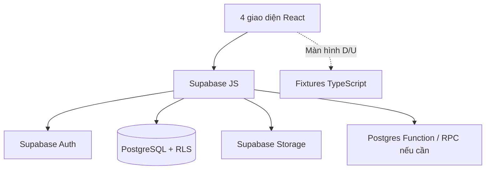

**Phiên bản:** 0.4 — Supabase-first, tối giản cho MVP 7 ngày

**Ngày cập nhật:** 13/10/2026

**Trạng thái:** ĐỀ XUẤT — CẦN TEAM/CHỦ DỰ ÁN CHỐT

**Baseline nghiệp vụ:** Scope & Requirements v0.2 (chưa có bằng chứng khách hàng ký duyệt).

> **Thay đổi kiến trúc lớn:** Thay Express + Prisma + custom sessions bằng Supabase Auth + PostgreSQL + RLS + Storage và Supabase JS. Không có Express API riêng trong MVP. **Không thay đổi mục tiêu bốn UI và các mức F/D/U/O đã nêu trong Scope.** Các đoạn chat, booking và tracking vẫn là demo, không tự nâng thành nghiệp vụ thật.
> 

## 1. Mục tiêu, phạm vi và tiêu chuẩn hoàn thành

- **04 giao diện:** Farmer, Buyer, Transporter/Carrier và Admin.
- **F (lưu thật):** Đăng nhập/duy trì phiên, phân quyền; hồ sơ Farmer, lô hàng và ảnh; yêu cầu thu mua Buyer; danh mục xe Carrier; matching gợi ý theo luật. **Đăng ký SĐT công khai và OTP SMS phải được duyệt riêng** vì cần cấu hình SMS, không mặc định hoạt động.
- **D (demo):** Chat/kết nối, booking/báo giá xe, tracking, giá và thời tiết, dashboard, các thao tác quản trị nội dung. Seed và nhãn “Dữ liệu minh họa” thay thế nghiệp vụ thực.
- **U:** Trang điều khoản/chính sách/chức năng cấu hình chưa có nghiệp vụ.
- **O:** Thanh toán, IoT/GPS realtime, tối ưu đa chặng/ML production, SMS thật nếu chưa chốt.
- Tiêu chí AC-01..10 của Scope không đổi; F phải lưu thật, truy cập đúng quyền, refresh vẫn còn dữ liệu. Mục tiêu lập kế hoạch **2 developers, 7 ngày** là giả định, không đảm bảo nếu có scope mới.

## 2. Kiến trúc và Tech stack chính thức được đề xuất

| Lớp | Công nghệ | Mục đích |
| --- | --- | --- |
| UI | React + TypeScript + Vite | SPA bốn vai trò |
| Style và route | Tailwind CSS + React Router | Giao diện và điều hướng |
| SDK dữ liệu | @supabase/supabase-js | Truy cập Auth, PostgreSQL API, Storage, RPC |
| Database | Supabase PostgreSQL | Dữ liệu F dùng chung nhiều tài khoản |
| Xác thực | Supabase Auth | Đăng nhập bằng tài khoản được cấp, quản lý phiên |
| Phân quyền | PostgreSQL Row Level Security (RLS) | Kiểm tra dữ liệu theo auth.uid() và vai trò |
| Ảnh | Supabase Storage | Upload/đọc ảnh theo policy |
| Matching | TypeScript rule-based hoặc PostgreSQL RPC | Xếp hạng gợi ý Buyer–Farmer |



**Không dùng:** Express, Prisma, Node API tự triển khai, custom session cookie, local upload server, Docker/CI/CD bắt buộc, Redis, WebSocket, microservices. Supabase có sẵn API từ bảng, nhưng **schema, RLS và policy Storage vẫn là backend cần code và test**.

## 3. Tổ chức repo và phân công full-stack theo feature

```
logstar/
├── src/
│   ├── app/                # routes, session provider, role guards
│   ├── pages/{farmer,buyer,carrier,admin,auth}/
│   ├── features/{profiles,lots,buy-requests,matching,vehicles}/
│   ├── components/ui/
│   ├── lib/supabase.ts
│   ├── lib/auth.ts
│   ├── mocks/              # giá, thời tiết, chat, booking, tracking, Admin
│   └── types/database.ts  # types generate từ Supabase khi schema ổn định
├── supabase/
│   ├── migrations/        # SQL tables, RLS, policies, indexes, functions
│   └── seed.sql           # seed dữ liệu demo, không có secrets
├── public/
├── .env.example
├── package.json
└── README.md
```

| Developer A — Feature Owner | Developer B — Feature Owner |
| --- | --- |
| **Farmer:** hồ sơ FR-02, lô FR-03, upload ảnh — UI, Supabase queries, RLS test | **Buyer:** yêu cầu BR-02, tìm/lọc BR-03 — UI, queries, RLS test |
| **Carrier:** CR-01/02 hồ sơ xe và UI demo vận chuyển | **Matching:** FR-04/BR-03, TypeScript scoring/RPC và UI kết quả |
| **Demo:** Farmer dashboard, giá/thời tiết, tracking, bản đồ | **Demo:** chat/kết nối, Buyer dashboard, toàn bộ Admin UI |
| **Chất lượng:** test Farmer/Carrier, responsive | **Chất lượng:** test Buyer/Matching/Admin, responsive |

**Chia đều:** Cả hai là developer full-stack feature, không chia người frontend và backend. Dev A điều phối component/theme/route, Dev B điều phối Supabase Auth/schema baseline; **cả hai bắt buộc review RLS và migration** khi sửa bảng liên quan. Không dùng service-role key trên frontend.

## 4. Thiết kế database và quyền sở hữu

**Quy ước:** UUID, thời gian UTC, tiền số nguyên VND/kg, khối lượng kg. Giữ bảng mức F tối thiểu:

| Bảng | Các trường chính | Quyền |
| --- | --- | --- |
| profiles | id = auth.users.id; full_name; phone_display; role FARMER/BUYER/CARRIER/ADMIN; created_at | Người dùng đọc/sửa thông tin cá nhân **nhưng không được tự sửa role** |
| farmer_profiles | user_id unique, farm_name, province, address, area_m2, tree_count, certifications | Farmer đọc/ghi của mình |
| buyer_profiles | user_id unique, organization_name, province | Buyer đọc/ghi của mình |
| carrier_profiles | user_id unique, company_name, service_provinces | Carrier đọc/ghi của mình |
| fruit_types | id, name, active | Đã đăng nhập đọc |
| lots | id, farmer_id, fruit_type_id, quantity_kg, price_vnd_per_kg, harvest_start/end, province, status | Farmer CRUD lô của mình; Buyer chỉ đọc PUBLISHED |
| lot_images | id, lot_id, storage_path, sort_order | Chỉ chủ lô được thêm/xóa liên kết ảnh |
| buy_requests | id, buyer_id, fruit_type_id, min/max kg, min/max price, required_start/end, province, status | Buyer CRUD yêu cầu của mình; match đọc yêu cầu OPEN theo chính sách được duyệt |
| vehicles | id, carrier_id, license_plate, capacity_kg, vehicle_type, provinces | Carrier CRUD xe của mình |

**Quan trọng:** Mọi bảng F bật RLS, index trên `owner_id` và trạng thái/tìm kiếm. Role nằm ở `profiles` nhưng **không được cho user tự cập nhật role**: cấp role bằng trigger/quy trình quản trị tin cậy, dùng privilege theo cột hoặc trigger bảo vệ cập nhật; nếu policy đọc role từ profiles phải tránh đệ quy RLS. Tài khoản ADMIN chỉ được cấp trong giao diện quản lý Supabase hoặc script backend an toàn, không từ form đăng ký công khai.

**Không có bảng bắt buộc cho:** chat messages, đơn hàng, booking, GPS, IoT, giá realtime. Chỉ bổ sung nếu Scope nâng từ D thành F.

## 5. Data access contract — thay thế REST API tự xây

Frontend truy cập Supabase SDK qua service/function gọn, **không rải câu lệnh Supabase khắp các component**.

| Feature | Thao tác Supabase | Phân quyền bắt buộc |
| --- | --- | --- |
| Đăng nhập | supabase.auth.signInWithPassword({phone,password}) | Chỉ tài khoản đã được tạo/xác minh hợp lệ |
| Phiên/đăng xuất | auth.getUser(), auth.onAuthStateChange(), auth.signOut() | Không tin role lưu thuần trong localStorage |
| Hồ sơ | from('farmer_profiles'/'buyer_profiles'/...).select/upsert | auth.uid() = user_id |
| Lô hàng | from('lots').select/insert/update | owner mới có quyền ghi; Buyer thấy PUBLISHED |
| Yêu cầu thu mua | from('buy_requests').select/insert/update | Buyer sở hữu yêu cầu |
| Xe | from('vehicles').select/insert/update | Carrier sở hữu xe |
| Ảnh | storage.from('lot-images').upload/getPublicUrl hoặc createSignedUrl | Bucket policy ràng buộc thư mục theo auth.uid(); ưu tiên private + signed URL nếu ảnh không hoàn toàn công khai |
| Matching | Select đã được RLS cho phép → hàm score; hoặc supabase.rpc('match_lots', params) | RPC không được vượt RLS hoặc tiết lộ dữ liệu Buyer/Farmer chưa được phép |

**Hợp đồng dữ liệu:** Chỉ lấy column cần, map lỗi thành thông báo tiếng Việt, form validate giá >0, khối lượng >0, ngày start≤end. Pagination qua `range()`; sort/filter bằng Supabase query; migration SQL là nguồn sự thật của schema.

**Không expose `service_role`, DB password hoặc admin secret ra mã React/Vite.** Frontend chỉ dùng Supabase URL và publishable/anon key.

## 6. Authentication/Authorization — thiết kế thực tế cho 7 ngày

1. **MVP an toàn nhất:** Tạo sẵn 4+ tài khoản demo được xác nhận và có mật khẩu; dùng Supabase Auth sign-in bằng số điện thoại + password (hoặc phương án email/password khi được chủ dự án duyệt). Giao diện đăng ký/OTP demo vẫn hiển thị nếu Scope yêu cầu, phải ghi rõ **không gửi/không xác minh SMS thật**.
2. **Nếu bắt buộc tự đăng ký SĐT thật:** cấu hình SMS provider, xác minh số và test rate-limit/cost; đây là thay đổi cần phê duyệt, **không được coi đã giải quyết chỉ nhờ bật Supabase Auth**.
3. Session do Supabase Auth quản lý; `onAuthStateChange` đồng bộ UI. Không tự phát session cookie Express nữa. Role từ `profiles` tải lại sau login; route guards chỉ là UX.
4. **RLS là cổng bảo mật:** Farmer sửa đúng lô của mình; Buyer chỉ sửa nhu cầu của mình; Carrier sửa xe của mình; Admin không tự có quyền toàn bảng nếu chưa có policy/quy trình tin cậy.
5. RLS policy cần **USING** cho SELECT/UPDATE/DELETE, **WITH CHECK** cho INSERT/UPDATE; kiểm tra chủ sở hữu và role, ngăn thay owner/role. Storage cần policy độc lập.
6. Người dùng chưa login, sai vai trò hoặc cố đọc/sửa bản ghi người khác phải bị từ chối ở **database/storage**, không phụ thuộc ẩn nút React.

**Ví dụ chính sách minh họa — không dùng nguyên xi khi chưa đủ các policy liên quan:**

```sql
alter table public.lots enable row level security;
create policy farmer_insert_own_lot on public.lots
for insert to authenticated
with check (
  farmer_id = (select auth.uid())
  and exists (select 1 from public.profiles p
    where p.id = (select auth.uid()) and p.role = 'FARMER')
);
```

Khi triển khai thật cần thêm SELECT/UPDATE/DELETE, bảo vệ owner và `profiles.role`, kiểm thử profile policy không đệ quy.

## 7. Matching: giữ thuật toán, thay nơi thực thi

**Phạm vi:** gợi ý Buyer–Farmer, không tự chốt giao dịch hoặc phân công xe. Điều kiện tối thiểu: cùng loại quả, khoảng ngày giao nhau, phù hợp khối lượng; điểm về giá, sản lượng và khu vực. Trọng số dự kiến 40/35/25 **chưa được khách hàng duyệt**.

**Lựa chọn MVP nhanh nhất:** đọc danh sách ứng viên được RLS cho phép bằng SDK → tính `scoreMatch(lot, request)` bằng **hàm TypeScript thuần**, sort và hiển thị lý do. Chỉ dùng khi tập dữ liệu demo nhỏ và matching **không quyết định quyền/giao dịch thực**.

**Khi matching cần truy vấn lớn hoặc điểm là quyết định quan trọng:** chuyển phần lọc/xếp hạng vào PostgreSQL function RPC với quyền invoker phù hợp và có test bảo mật, không cần dựng Express hoặc Edge Function mặc định.

**Tests:** khác loại quả, ngày không giao nhau, giá ngoài range, lượng thiếu, khu vực khác, tie score, dữ liệu ứng viên không được phép xem. Không tiết lộ số điện thoại/chứng nhận riêng tư khi chưa có quy tắc cho phép.

## 8. Luồng nghiệp vụ được giữ nguyên

- **FLOW-01 — Farmer:** login Supabase Auth → ghi hồ sơ (`farmer_profiles`) → upload Storage → tạo/công bố `lots` → Buyer nhìn thấy lô PUBLISHED → matching gợi ý.
- **FLOW-02 — Buyer:** login → tạo `buy_requests` → lọc `lots` → xem score → mở giao diện kết nối/chat **D** (không có tin nhắn realtime).
- **FLOW-03 — Transporter:** Farmer/Buyer điền form yêu cầu xe **D** → Carrier xem fixture, báo giá/nhận chuyến **D** → tracking timeline **D**; không ghi “đã đặt xe thật”.
- **FLOW-04 — Admin:** đăng nhập bằng tài khoản ADMIN được cấp trước → xem số liệu/ danh sách mẫu **D/U**; nút khóa/xóa/duyệt chỉ demo trừ khi được phê duyệt thêm.

**Quy tắc UI:** F đọc DB thật, D/U đọc fixtures được gắn nhãn; không trộn số KPI mẫu với số thực khiến người dùng hiểu nhầm. Tất cả màn có loading, empty, error và trường hợp không có match.

## 9. Ma trận triển khai theo yêu cầu Scope

| Mã Scope | Phần triển khai thật/demo | Owner |
| --- | --- | --- |
| FR-01 / BR-01 / CR-01 | Supabase Auth + profile role; tài khoản pre-created, OTP demo nếu cần | Chung (Dev B điều phối Auth) |
| FR-02 / FR-03 | Farmer CRUD, lots, Storage, RLS | Dev A |
| BR-02 / BR-03 | Buyer requirements, tìm/lọc lô, RLS | Dev B |
| FR-04 + BR-03 | Matching rule TypeScript, UI kết quả, test | Dev B; Dev A tích hợp Farmer |
| CR-01 / CR-02 | Carrier profile/vehicles CRUD và RLS | Dev A |
| Farmer dashboard, giá, thời tiết, vận chuyển | Seed/fixture + UI | Dev A |
| Chat, Buyer dashboard, Admin | Seed/fixture + UI | Dev B |
| FR/BR reviews, maps, tracking | Màn D/U rõ nhãn, không GPS thực | Theo domain owner |

**Giữ nguyên đầy đủ 4 giao diện và tất cả màn đã chốt.** Phần nào mới phát sinh nghiệp vụ server-side phải cập nhật Scope và migration/RLS trước khi code.

## 10. Coding convention & quy chuẩn tích hợp tối thiểu

- React Function Components, TypeScript `strict`; đặt tên component PascalCase, hàm camelCase, thư mục kebab-case.
- Một Supabase client duy nhất tại `src/lib/supabase.ts`. Mỗi feature gom query vào file `*.api.ts`; không đọc trực tiếp bảng ở nhiều màn khó kiểm soát.
- Dùng `useEffect`/state hoặc hooks nhẹ cho fetch; **không bắt buộc TanStack Query**. Sau create/update/delete refetch dữ liệu; luôn có loading/error.
- Schema thay đổi bằng **SQL migration** trong `supabase/migrations`, không sửa trực tiếp giao diện database production rồi bỏ quên mã nguồn.
- Row ownership lấy từ user Auth, không tin `user_id` gửi từ browser. Dữ liệu tiền VND/kg và khối lượng kg phải thống nhất frontend/database.
- PR theo feature owner, reviewer là developer còn lại. **Mọi PR đổi RLS, auth hoặc role phải kiểm thử bằng hai tài khoản khác nhau trước khi merge.**
- Không commit `.env.local`, API secret, service-role key, password. Log lỗi không ghi token hoặc thông tin đăng nhập.

## 11. Setup, môi trường và triển khai

```
# .env.local — chỉ publishable/anon key; không commit
VITE_SUPABASE_URL=https://PROJECT_REF.supabase.co
VITE_SUPABASE_PUBLISHABLE_KEY=YOUR_PUBLIC_KEY
```

**Bước thiết lập:** 1. Tạo Supabase project; 2. Thiết lập Auth và tài khoản demo; 3. Chạy migration SQL (tables + indexes + RLS + Storage policies); 4. Tạo bucket `lot-images`; 5. Seed dữ liệu demo; 6. `npm install`, `npm run dev`; 7. Chạy manual tests theo AC; 8. `npm run build` và deploy static frontend lên hosting HTTPS phù hợp.

**Không cần Express server deploy riêng.** Staging cần cấu hình Supabase Auth site URL/redirect URL đúng hostname, key client public, bật RLS cho mọi bảng được expose. Nếu dùng client-side SPA, hosting phải fallback route về index.html.

**Backup:** lưu migration SQL + seed có thể chạy lại; thao tác sửa schema nhạy cảm phải backup DB. **Không dùng key admin trên frontend.**

## 12. Kiểm thử và tiêu chí nghiệm thu

| AC | Cách kiểm thử |
| --- | --- |
| AC-01 | Mở toàn bộ route Farmer/Buyer/Carrier/Admin, không có màn trắng |
| AC-02 | F CRUD persisted trên Supabase; reload/đăng nhập lại còn dữ liệu |
| AC-03 | Hai tài khoản khác vai trò/chủ sở hữu: thử sửa/đọc trái quyền, RLS phải chặn |
| AC-04 | Matching cùng input cho cùng score + lý do, ít nhất 3 tình huống |
| AC-05 | Demo FLOW-01..04 liền mạch, chỉ rõ chuyển F→D |
| AC-06 | Form bắt buộc, ngày sai, giá âm, upload sai định dạng |
| AC-07 | Desktop + mobile viewport đã duyệt |
| AC-08 | Giá, thời tiết, tracking, chat mock được dán nhãn |
| AC-09 | Không lỗi blocker; liệt kê lỗi nhỏ còn lại |
| AC-10 | Đối chiếu ma trận F/D/U và deliverables |

**Test bảo mật thêm:** user sửa `profiles.role` thành ADMIN, giả mạo farmer_id, sửa lot người khác, upload vào folder người khác, query dữ liệu không được phép, client lộ service key (phải không có).

## 13. Kế hoạch 7 ngày — hai developer ngang vai trò

| Ngày | Developer A | Developer B | Điểm kiểm tra |
| --- | --- | --- | --- |
| 1 | Scaffold React, UI kit, Farmer/Carrier routes | Setup Supabase Auth, schema/RLS baseline, Buyer/Admin routes | 2 tài khoản đăng nhập và role hoạt động |
| 2 | Farmer profile end-to-end + RLS | Buyer request end-to-end + RLS | Hai domain lưu DB |
| 3 | Lots CRUD + upload Storage | Buyer lọc lô & yêu cầu mua | Farmer đăng, Buyer xem |
| 4 | Vehicle CRUD + UI matching Farmer | Matching TS score + Buyer/Farmer results | Chạy luồng F |
| 5 | Farmer/Carrier demo UI và tracking/giá | Chat/Buyer/Admin demo UI | Đủ 4 giao diện |
| 6 | Responsive A và test RLS A | Responsive B và test RLS B | Test cross-role + FLOW-01..04 |
| 7 | Bugfix, hướng dẫn demo | Bugfix, seed/README, deploy frontend | Nghiệm thu AC-01..10 |

Nếu phát sinh SMS OTP thật, Admin mutation hoặc chat thật thì cần đánh giá lại thời hạn; **không gộp vào 7 ngày khi chưa được duyệt**.

## 14. Quyết định còn mở trước khi code

| Mã | Cần xác nhận | Mặc định tạm |
| --- | --- | --- |
| OPEN-01 | Scope v0.2 đã được khách hàng duyệt chưa? | Chưa; coi là proposal |
| OPEN-02 | Cho phép tài khoản demo tạo sẵn thay đăng ký SĐT thật? | Dùng tài khoản tạo sẵn |
| OPEN-03 | SĐT/password có cần xác minh SMS/OTP thực? | Không triển khai SMS thật |
| OPEN-04 | Matching chỉ gợi ý, không chốt giao dịch tự động? | Chỉ gợi ý |
| OPEN-05 | Trọng số và điều kiện lọc matching? | Đề xuất 40/35/25 chờ duyệt |
| OPEN-06 | Mức Admin thực hay demo? | Demo |
| OPEN-07 | Ảnh công khai hay cần signed URL? | Private bucket + signed URL |
| OPEN-08 | Đăng ký public có được phép tự chọn role? | Chỉ 3 role thường, không Admin |
| OPEN-09 | Chat/booking/transport có cần lưu đồng bộ nhiều tài khoản? | D fixtures |
| OPEN-10 | Tên thương hiệu, loại trái cây, mockup và hosting? | LogStar/3 trái cây đề xuất, staging tùy có |

## 15. Bàn giao và quy tắc quản trị tài liệu

- React repo + `README.md`, `.env.example`, migration SQL, seed, Supabase RLS/storage policies.
- 4 giao diện và demo dữ liệu hợp lý; login test, checklist AC-01..10 và kết quả thử phân quyền.
- Bản ghi chức năng nào là F/D/U; người duyệt Scope/TDD và các Change Request.
- **Thứ tự ưu tiên:** Scope đã duyệt > TDD đã duyệt > schema/policies trong repo > code. Nếu mâu thuẫn, phải xác nhận trước khi triển khai.

## 16. Bảng DIFF — TDD trước vs Supabase-first v0.4

| Hạng mục | Trước | Sau | Tác động |
| --- | --- | --- | --- |
| Express REST API | Tự code route/server và deploy API | Bỏ; Supabase JS + PostgREST/RPC | Giảm backend boilerplate |
| Prisma | Schema và Prisma Migrate | Bỏ; SQL migrations Supabase | Cần viết SQL/policies |
| Custom Auth + Cookie | bcrypt, sessions table, Express middleware | Supabase Auth + Auth session | Giảm tự xử lý session/password |
| Authorization | Role middleware của Express | RLS database + role bảo vệ | Bắt buộc test policy kỹ |
| Upload | Express + local volume | Supabase Storage | Bỏ server upload, thêm bucket policies |
| Repository | web/ + api/ | Một Vite React app + supabase/migrations | Bớt repo/tooling |
| Data fetching | REST fetch/client wrapper | Supabase JS query | Đơn giản CRUD |
| Matching | Hàm TS hoặc Express service | Hàm TS; SQL RPC nếu cần bảo vệ/mở rộng | Giữ thuật toán |
| Docker/CI | Không bắt buộc ở bản đơn giản trước | Tiếp tục không bắt buộc | Tiết kiệm setup |
| 4 UI | Farmer, Buyer, Carrier, Admin | Giữ nguyên | Không cắt giao diện |
| F/D/U | Scope v0.2 | Giữ nguyên | Không tăng chức năng |
| SĐT/OTP | SĐT/password + OTP mock | Supabase Auth; account demo tạo sẵn, OTP mock | **Cần duyệt thay đổi đăng ký công khai** |

**Không bị lược bỏ:** Profile, Lots, Buy Requests, Vehicles, Matching, uploads, authorization, bốn UI và luồng demo. **Thay đổi lớn nhất:** Không còn backend Node/Express, nhưng độ đúng của RLS và quản lý tài khoản Supabase phải được kiểm thử.