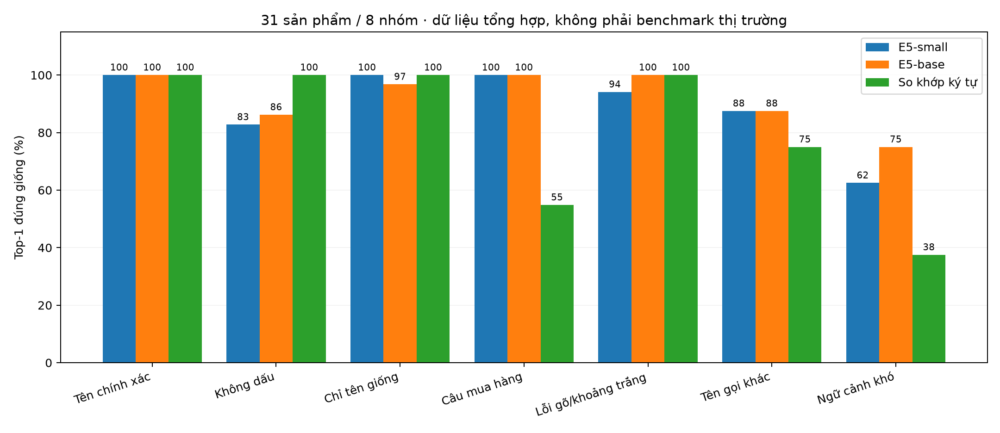
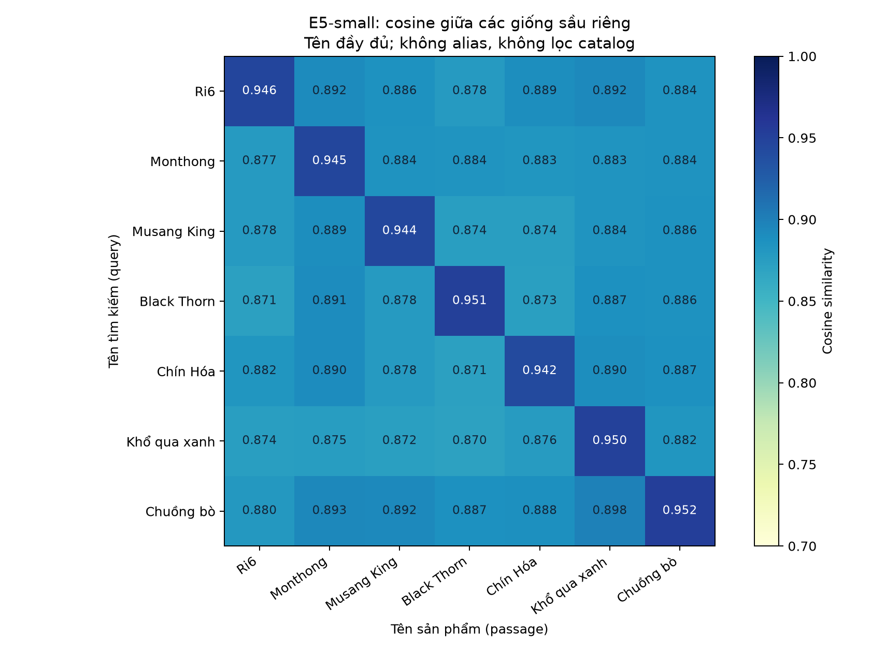
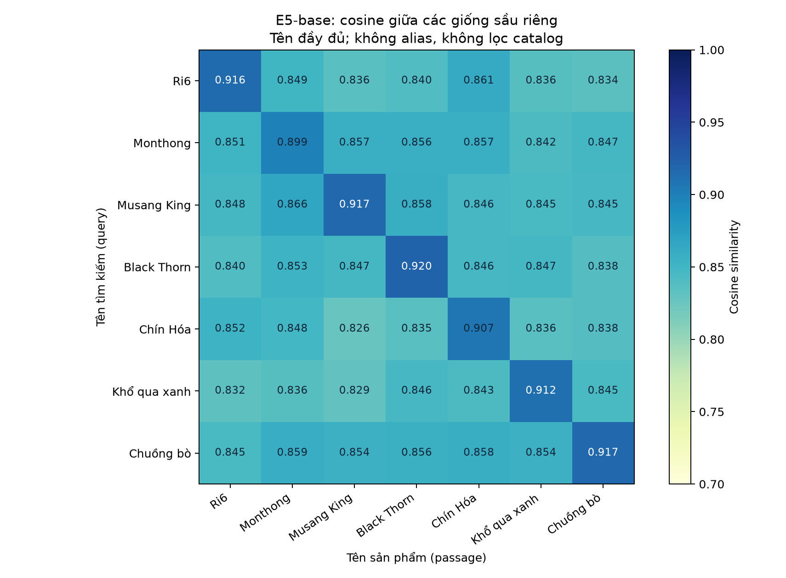
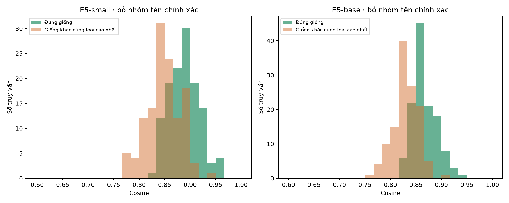

# Benchmark local E5 với tên giống nông sản

Ngày 15/10/2026 · CPU local · không fine-tune · không ghi dữ liệu Supabase · chưa bật hybrid trong app.

Fixture: **31 tên sản phẩm / 8 nhóm / 171 truy vấn**; 155 có nhãn đích và 16 ca mơ hồ/ngoài danh mục chỉ quan sát.

Đây là phép thử kỹ thuật nhỏ với nhãn do tác giả đặt trước khi chạy model, chưa có chuyên gia gán nhãn độc lập. Các biến thể cùng sản phẩm có tương quan; số liệu không phải ước lượng accuracy ngoài thực tế. Danh mục gồm cả nhóm tên thương mại, không phải hệ thống phân loại giống thực vật đã kiểm định.

## Nhận xét từ lượt chạy này

- E5-small đúng 145/155, E5-base đúng 147/155 ở name-only. Bỏ 31 ca exact dễ: small đúng 114/124, base đúng 116/124. Chênh lệch nhỏ, chưa đủ để kết luận model nào tốt hơn trên thị trường.
- Cả hai đúng 41/45 ca sầu riêng có nhãn; tên giống chuẩn phân biệt được trong catalog này. Dữ liệu không dấu vẫn gây nhầm sang cả loại quả khác.
- Với `Sầu riêng RD6`: small ưu tiên Ri6 (0.9281), base ưu tiên Ri6 (0.9030). RD6 không có nhãn chuẩn nên đây là gợi ý, không được tính là một ca đúng.
- Với `Xoài Cát Chu, không lấy Cát Hòa Lộc`: cả hai ưu tiên sai Cát Hòa Lộc. Cosine không đủ để thực thi điều kiện phủ định.
- Thêm alias làm đúng 8/8 ca alias nhưng không bảo đảm cải thiện tổng thể. Cần đối chiếu alias có cấu trúc trong catalog thay vì chỉ nối mọi alias vào đoạn encode.
- Small khoảng 25 ms/query và 1.17 GiB peak RSS; base khoảng 51 ms và 1.80 GiB. Small phù hợp prototype local nhẹ hơn; chưa thay model/dimension trong app.
- Hướng triển khai: dùng tên/alias/catalog xác định sản phẩm, cosine gợi ý khi chưa rõ; xác nhận trường hợp mơ hồ rồi mới so giá/lượng/khoảng cách. Chưa chọn ngưỡng cosine production.

## Phương pháp

- Tập ứng viên cố định: một passage tên chuẩn cho mỗi sản phẩm; tìm kiếm toàn bộ 31 ứng viên bằng cosine, không lọc loại trước.
- Dùng prefix `query:` / `passage:`, vector chuẩn hóa L2, FP32, CPU 4 luồng, batch 8, tối đa 512 token.
- Primary: **name_only**. Thử nghiệm phụ **alias_enriched** thêm tên gọi khác vào passage; không trộn hai kết quả.
- Baseline ký tự: bỏ dấu/chữ thường/ký tự phân cách rồi so SequenceMatcher; không có alias hay embedding. Đây không phải BM25 hoặc search production.
- Hit@1: top đầu đúng giống; Hit@3: đích có trong top 3; MRR: trung bình nghịch đảo thứ hạng. Mỗi query có đúng một đích.
- Margin cùng loại = cosine đích trừ cosine cao nhất của giống khác cùng loại. Margin âm nghĩa là model ưu tiên sai giống.
- RD6/mô tả chung/ngoài danh mục không có nhãn đích: không tính chúng vào accuracy và không tự sửa RD6 thành Ri6.
- Giá/lượng/vị trí trong câu chỉ là từ gây nhiễu; không đánh giá lọc nghiệp vụ, khoảng cách hoặc graph ở phép thử này.
- Không chọn hay công bố ngưỡng cosine an toàn trên chính tập thử này. Chưa có validation/test độc lập.

SHA256 fixture: `8af46809d37cc7a0f6e3287ff527815ed58ed8c6bcfa69da4145316d2a3c2576`

## Kết quả chính: tên chuẩn trong catalog

| Phương án | Có nhãn | Top-1 | Hit@3 | MRR | Top-1 bỏ exact |
| --- | ---: | ---: | ---: | ---: | ---: |
| E5-small | 155 | 93.5% | 100.0% | 0.963 | 91.9% |
| E5-base | 155 | 94.8% | 100.0% | 0.971 | 93.5% |
| Baseline ký tự | 155 | 86.5% | 91.0% | 0.903 | 83.1% |



## Tách nhóm truy vấn

| Nhóm | Số ca | E5-small Top-1 | E5-base Top-1 | Ký tự Top-1 |
| --- | ---: | ---: | ---: | ---: |
| Tên chính xác | 31 | 100.0% | 100.0% | 100.0% |
| Không dấu | 29 | 82.8% | 86.2% | 100.0% |
| Chỉ tên giống | 31 | 100.0% | 96.8% | 100.0% |
| Câu mua hàng | 31 | 100.0% | 100.0% | 54.8% |
| Lỗi gõ/khoảng trắng | 17 | 94.1% | 100.0% | 100.0% |
| Tên gọi khác | 8 | 87.5% | 87.5% | 75.0% |
| Ngữ cảnh khó | 8 | 62.5% | 75.0% | 37.5% |

## Tách nhóm nông sản (gồm các ca exact)

| Nhóm | Số ca | E5-small Top-1 | E5-base Top-1 |
| --- | ---: | ---: | ---: |
| dragonfruit | 16 | 100.0% | 87.5% |
| durian | 45 | 91.1% | 91.1% |
| grape | 8 | 100.0% | 100.0% |
| jackfruit | 12 | 100.0% | 100.0% |
| longan | 13 | 92.3% | 100.0% |
| mango | 19 | 94.7% | 94.7% |
| pomelo | 19 | 78.9% | 94.7% |
| rice | 23 | 100.0% | 100.0% |

## Thử thêm alias vào passage

Đây là thí nghiệm có cấp thêm thông tin: alias dùng trong một số query xuất hiện trong passage enriched. Mức tăng không phải bằng chứng model tự biết alias hoặc khả năng tổng quát sang alias mới.

| Model | Name-only Top-1 | Enriched Top-1 | Alias name-only | Alias enriched |
| --- | ---: | ---: | ---: | ---: |
| small | 93.5% | 93.5% | 87.5% | 100.0% |
| base | 94.8% | 94.2% | 87.5% | 100.0% |

## Cosine giữa các giống sầu riêng

Trục dọc là query tên đầy đủ, trục ngang là passage tên đầy đủ; cosine query→passage không bắt buộc đối xứng. Đường chéo và nhiều giống khác đều có thể có điểm cao. Điểm không phải xác suất đúng giống.







## Các trường hợp cần xem trực tiếp

| Model | Query | Đích | Top-1 · cosine | Top-2 · cosine | Hạng đích |
| --- | --- | --- | --- | --- | ---: |
| small | Sầu riêng Ri6 | Sầu riêng Ri6 | Sầu riêng Ri6 · 0.9462 | Sầu riêng Khổ qua xanh · 0.8923 | 1 |
| base | Sầu riêng Ri6 | Sầu riêng Ri6 | Sầu riêng Ri6 · 0.9156 | Sầu riêng Chín Hóa · 0.8612 | 1 |
| small | Sầu riêng RD6 | Không gán đích | Sầu riêng Ri6 · 0.9281 | Sầu riêng Khổ qua xanh · 0.8915 | — |
| base | Sầu riêng RD6 | Không gán đích | Sầu riêng Ri6 · 0.9030 | Sầu riêng Chín Hóa · 0.8560 | — |
| small | RD6 | Không gán đích | Sầu riêng Ri6 · 0.8181 | Bưởi Diễn · 0.8033 | — |
| base | RD6 | Không gán đích | Sầu riêng Ri6 · 0.8241 | Thanh long Ruột tím hồng LĐ5 · 0.7698 | — |
| small | Sầu riêng R16 | Sầu riêng Ri6 | Sầu riêng Ri6 · 0.9189 | Sầu riêng Monthong · 0.8962 | 1 |
| base | Sầu riêng R16 | Sầu riêng Ri6 | Sầu riêng Ri6 · 0.8867 | Sầu riêng Monthong · 0.8505 | 1 |
| small | Sầu riêng Dona | Sầu riêng Monthong | Sầu riêng Monthong · 0.8855 | Sầu riêng Khổ qua xanh · 0.8841 | 1 |
| base | Sầu riêng Dona | Sầu riêng Monthong | Sầu riêng Monthong · 0.8559 | Sầu riêng Chín Hóa · 0.8519 | 1 |
| small | Cần Ri6, không mua Monthong | Sầu riêng Ri6 | Sầu riêng Monthong · 0.8767 | Sầu riêng Ri6 · 0.8751 | 2 |
| base | Cần Ri6, không mua Monthong | Sầu riêng Ri6 | Sầu riêng Ri6 · 0.8611 | Sầu riêng Monthong · 0.8382 | 1 |
| small | Cần Monthong, không mua Ri6 | Sầu riêng Monthong | Sầu riêng Ri6 · 0.8795 | Sầu riêng Monthong · 0.8714 | 2 |
| base | Cần Monthong, không mua Ri6 | Sầu riêng Monthong | Sầu riêng Ri6 · 0.8586 | Sầu riêng Monthong · 0.8427 | 2 |
| small | Gạo ST25, không phải ST24 | Lúa ST25 | Lúa ST25 · 0.8730 | Lúa ST24 · 0.8593 | 1 |
| base | Gạo ST25, không phải ST24 | Lúa ST25 | Lúa ST25 · 0.8479 | Lúa ST24 · 0.8452 | 1 |
| small | Xoài Cát Chu, không lấy Cát Hòa Lộc | Xoài Cát Chu | Xoài Cát Hòa Lộc · 0.9070 | Xoài Cát Chu · 0.8943 | 2 |
| base | Xoài Cát Chu, không lấy Cát Hòa Lộc | Xoài Cát Chu | Xoài Cát Hòa Lộc · 0.8791 | Xoài Cát Chu · 0.8646 | 2 |
| small | Thanh long ruột đỏ LĐ1, không lấy ruột trắng | Thanh long Ruột đỏ LĐ1 | Thanh long Ruột đỏ LĐ1 · 0.9048 | Thanh long Ruột tím hồng LĐ5 · 0.8917 | 1 |
| base | Thanh long ruột đỏ LĐ1, không lấy ruột trắng | Thanh long Ruột đỏ LĐ1 | Thanh long Ruột đỏ LĐ1 · 0.8833 | Thanh long Ruột tím hồng LĐ5 · 0.8637 | 1 |
| small | Sầu riêng D9999 | Không gán đích | Sầu riêng Chín Hóa · 0.8902 | Sầu riêng Ri6 · 0.8886 | — |
| base | Sầu riêng D9999 | Không gán đích | Sầu riêng Ri6 · 0.8557 | Sầu riêng Chín Hóa · 0.8517 | — |
| small | Chuối Cavendish | Không gán đích | Xoài Cát Chu · 0.8518 | Xoài Keo · 0.8307 | — |
| base | Chuối Cavendish | Không gán đích | Xoài Cát Chu · 0.8128 | Nhãn Xuồng cơm vàng · 0.8095 | — |

## Mọi trường hợp top-1 sai (name-only)

| Model | Query | Đích (cosine) | Top sai (cosine) | Hạng đích |
| --- | --- | --- | --- | ---: |
| small | sau rieng chuong bo | Sầu riêng Chuồng bò (0.8499) | Nhãn Tiêu da bò (0.8561) | 2 |
| small | buoi nam roi | Bưởi Năm Roi (0.8471) | Nhãn Tiêu da bò (0.8692) | 3 |
| small | buoi dien | Bưởi Diễn (0.8453) | Nhãn Tiêu da bò (0.8760) | 3 |
| small | buoi doan hung | Bưởi Đoan Hùng (0.8349) | Nhãn Tiêu da bò (0.8706) | 3 |
| small | nhan tieu da bo | Nhãn Tiêu da bò (0.8529) | Nhãn Ido (0.8533) | 2 |
| small | buoi nam roii | Bưởi Năm Roi (0.8446) | Nhãn Tiêu da bò (0.8577) | 2 |
| small | Sầu riêng Đô Na | Sầu riêng Monthong (0.8823) | Sầu riêng Khổ qua xanh (0.8835) | 3 |
| small | Cần Ri6, không mua Monthong | Sầu riêng Ri6 (0.8751) | Sầu riêng Monthong (0.8767) | 2 |
| small | Cần Monthong, không mua Ri6 | Sầu riêng Monthong (0.8714) | Sầu riêng Ri6 (0.8795) | 2 |
| small | Xoài Cát Chu, không lấy Cát Hòa Lộc | Xoài Cát Chu (0.8943) | Xoài Cát Hòa Lộc (0.9070) | 2 |
| base | sau rieng chin hoa | Sầu riêng Chín Hóa (0.8284) | Xoài Cát Hòa Lộc (0.8364) | 3 |
| base | sau rieng chuong bo | Sầu riêng Chuồng bò (0.8225) | Nhãn Tiêu da bò (0.8272) | 3 |
| base | buoi dien | Bưởi Diễn (0.8443) | Nhãn Tiêu da bò (0.8444) | 2 |
| base | thanh long ruot trang | Thanh long Ruột trắng (0.8212) | Thanh long Ruột đỏ LĐ1 (0.8387) | 3 |
| base | Ruột trắng | Thanh long Ruột trắng (0.8536) | Mít Ruột đỏ (0.8550) | 2 |
| base | Sầu riêng Đô Na | Sầu riêng Monthong (0.8558) | Sầu riêng Chín Hóa (0.8572) | 2 |
| base | Cần Monthong, không mua Ri6 | Sầu riêng Monthong (0.8427) | Sầu riêng Ri6 (0.8586) | 2 |
| base | Xoài Cát Chu, không lấy Cát Hòa Lộc | Xoài Cát Chu (0.8646) | Xoài Cát Hòa Lộc (0.8791) | 2 |

## Hiệu năng local

Độ trễ đã warmup, 24 lần encode một query, loại thời gian tải model/network/database. Đây là đo trên laptop dùng chung đang chạy ứng dụng khác, không phải tải đồng thời hoặc cam kết SLA. RSS là bộ nhớ tiến trình đo bằng psutil, không phải tổng RAM máy.

| Model | Chiều | Trọng số + tokenizer local | Load | Encode toàn bộ query | p50 / p95 một query | Peak RSS |
| --- | ---: | ---: | ---: | ---: | ---: | ---: |
| small | 384 | 475 MiB | 5.1s | 1.8s | 24.7 / 32.2 ms | 1196 MiB |
| base | 768 | 1082 MiB | 6.3s | 5.7s | 50.9 / 60.7 ms | 1846 MiB |

## Tái lập và dữ liệu thô

- Fixture: `services/embedding/benchmarks/variety-fixture.json` (nhãn được tạo trước chạy inference).
- `small.json`, `base.json`: toàn bộ thứ hạng, metadata thư viện/CPU/revision, metrics và thời gian.
- [CSV mọi điểm cosine](all-rankings.csv); `*-name-pairs.csv`: ma trận tên query→passage toàn catalog.
- `*-scores.npz`: ma trận số cho phân tích lại, không cần tải model.

```powershell
services/embedding/.venv/Scripts/python.exe services/embedding/benchmarks/run_benchmark.py --model small --model-dir tmp/e5-models/small
services/embedding/.venv/Scripts/python.exe services/embedding/benchmarks/run_benchmark.py --model base --model-dir tmp/e5-models/base
services/embedding/.venv/Scripts/python.exe services/embedding/benchmarks/report_benchmark.py
```

Model và môi trường ảo nằm trong thư mục Git ignore. Không push trong lượt này.

## Nguồn đối chiếu tên/alias

- [Ri6 và DONA (Monthong)](https://khuyennong.lamdong.gov.vn/UpLoaded/files/2025/sauriengVIETGAP.pdf)
- [LĐ1 và LĐ5](https://khuyennongvn.gov.vn/portals/0/tailieu/2018/05/quynhkn/sach_thanh_long_in.pdf)
- [NH01-48 và NH01-152](https://khuyennongvn.gov.vn/hoat-dong-khuyen-nong/chuyen-giao-tbkt/ninh-thuan-giong-nho-moi-tren-vung-dat-nang-16700.html)
- [Mã lúa ST24/ST25/OM18/OM5451](https://khuyennongvn.gov.vn/hoat-dong-khuyen-nong/thong-tin-huan-luyen/mot-so-giai-phap-de-trien-khai-tot-san-xuat-vu-dong-xuan-2024-2025-vung-dbscl-28180.html)

Model: `intfloat/multilingual-e5-small` · revision `614241f622f53c4eeff9890bdc4f31cfecc418b3` · thư viện `{"torch": "2.14.1+cpu", "transformers": "5.19.0", "sentence-transformers": "5.7.0", "numpy": "2.5.4", "psutil": "7.2.2"}`

Model: `intfloat/multilingual-e5-base` · revision `d13f1b27baf31030b7fd040960d60d909913633f` · thư viện `{"torch": "2.14.1+cpu", "transformers": "5.19.0", "sentence-transformers": "5.7.0", "numpy": "2.5.4", "psutil": "7.2.2"}`
