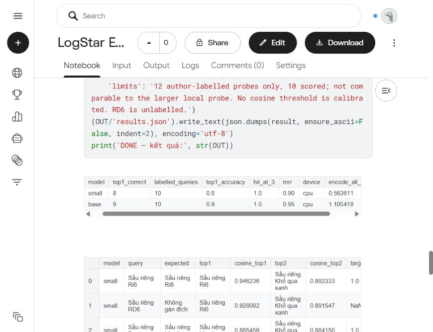

# E5 — 12 ca thử trên Kaggle

Đã chạy xong ngày 15/10/2026 trên **CPU Kaggle**, không inference local trong lượt này. Notebook private: [Version 1](https://www.kaggle.com/code/tunlnh/logstar-e5-12-variety-cases?scriptVersionId=358645506). Tổng runtime 2m 8s, gồm cài thư viện và tải model.

12 truy vấn tìm trong 31 tên sản phẩm; 10 ca có nhãn, RD6 và Chuối Cavendish không chấm đúng/sai. Đây là fixture tổng hợp nhỏ, không phải accuracy thực tế. Bộ này khác bộ local trước đó.

| Model | Top-1 đúng | Hit@3 | MRR | Encode 31 tên + 12 query |
| --- | ---: | ---: | ---: | ---: |
| E5-small | 8/10 | 10/10 | 0.90 | 0.564s |
| E5-base | 9/10 | 10/10 | 0.95 | 1.105s |

Thời gian encode loại thời gian tải/cài model, không phải độ trễ server hoặc tải đồng thời. Mỗi model chạy một lượt, không train/fine-tune.

## Một số kết quả E5-base

| Query | Top-1 · cosine | Top-2 · cosine | Nhận xét |
| --- | --- | --- | --- |
| Sầu riêng Ri6 | Ri6 · 0.915612 | Chín Hóa · 0.861174 | Đúng giống |
| Sầu riêng RD6 | Ri6 · 0.902955 | Chín Hóa · 0.855951 | Chỉ là gợi ý; chưa xác nhận RD6 là Ri6 |
| Sầu riêng Dona | Monthong · 0.855917 | Chín Hóa · 0.851917 | Đúng nhãn, chênh lệch chỉ khoảng 0.004 |
| Xoài Cát Chu | Cát Chu · 0.883517 | Cát Hòa Lộc · 0.861421 | Đúng giống |
| Xoài Cát Chu, không lấy Cát Hòa Lộc | Cát Hòa Lộc · 0.879088 | Cát Chu · 0.864590 | Sai do câu có phủ định |
| Lúa ST25 | ST25 · 0.937826 | ST24 · 0.910117 | Giống sai cũng có cosine trên 0.9 |
| Gạo ST25, không phải ST24 | ST25 · 0.847937 | ST24 · 0.845230 | Đúng nhưng chênh lệch rất nhỏ |
| Chuối Cavendish | Xoài Cát Chu · 0.812839 | Nhãn Xuồng cơm vàng · 0.809454 | Không có trong danh mục; không được ép chọn top-1 |

Small còn nhầm `Cần Ri6, không mua Monthong`: Monthong 0.876722 > Ri6 0.875120. Base chọn đúng Ri6 ở câu này nhưng cả hai đều nhầm câu phủ định xoài.

Kết quả hỗ trợ dùng cosine để tìm gợi ý. Để ưu tiên đúng sản phẩm, cần phối hợp tên/alias/catalog và xử lý phủ định; chưa đặt một ngưỡng cosine cố định từ mẫu này. Chưa bật hybrid hoặc thay model trong app.

- [Bảng kết quả đọc từ Kaggle](rendered-tables.json): số hiển thị 6 chữ số thập phân, không phải file raw toàn precision.
- `summary.csv`, `top2.csv`: trích từ chính bảng hiển thị trên Kaggle.
- File đầy đủ `results.json`, `top3.csv`, `cosine-all.csv` có trong tab Output của notebook.
- Nguồn notebook local: `services/embedding/benchmarks/logstar-e5-kaggle-12-cases.ipynb`.

