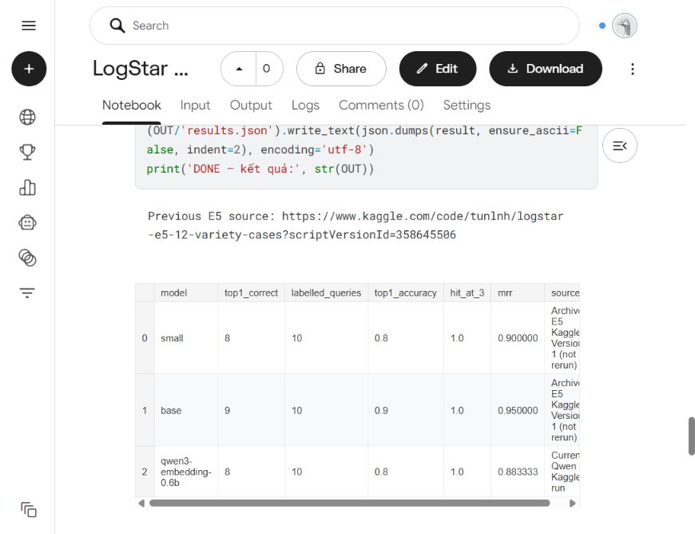

# Qwen3-Embedding-0.6B — cùng 12 ca với E5

Đã chạy xong trên **CPU Kaggle** ngày 15/10/2026. [Notebook private, Version 1](https://www.kaggle.com/code/tunlnh/logstar-qwen-embedding-12-cases?scriptVersionId=358653978). Runtime **1m 53s**, gồm cài thư viện/tải model; thời gian encode 31 tên và 12 query là **8.686203s**. Không chạy model local trong lượt này.

## Kết quả

| Model | Top-1 đúng | Hit@3 | MRR |
| --- | ---: | ---: | ---: |
| E5-small (lượt Kaggle trước) | 8/10 | 10/10 | 0.900000 |
| E5-base (lượt Kaggle trước) | 9/10 | 10/10 | 0.950000 |
| Qwen3-Embedding-0.6B + instruction | 8/10 | 10/10 | 0.883333 |

**Trong mẫu này Qwen chưa tốt hơn E5-base.** Chỉ có 10 ca có nhãn, chưa đủ khẳng định model nào tốt hơn ngoài thực tế. Hai query RD6 và Chuối Cavendish không được tính accuracy. E5 dùng kết quả đã lưu từ Version 1 trước đó, không chạy lại E5.

## Hai ca sai top-1 của Qwen

| Query | Top-1 sai · cosine | Đáp án đúng | Hạng đích |
| --- | --- | --- | ---: |
| Sầu riêng Dona | Ri6 · 0.595665 | Monthong | 3 |
| Xoài Cát Chu, không lấy Cát Hòa Lộc | Cát Hòa Lộc · 0.650550 | Cát Chu · 0.638215 | 2 |

Qwen vẫn nhầm phủ định ở câu xoài, và chưa ánh xạ alias Dona về Monthong trong trường hợp này. Đã không thêm alias vào passage hoặc lọc loại trước, để giữ nguyên phép thử E5.

## Một số cosine thực tế của Qwen

| Query | Top-1 · cosine | Top-2 · cosine | Kết quả |
| --- | --- | --- | --- |
| Sầu riêng Ri6 | Ri6 · 0.773666 | Musang King · 0.588065 | Đúng |
| Sầu riêng RD6 | Ri6 · 0.712132 | Musang King · 0.561334 | Chỉ gợi ý, không gán nhãn đúng/sai |
| sau rieng ri6 | Ri6 · 0.673947 | Musang King · 0.541690 | Đúng |
| Cần Ri6, không mua Monthong | Ri6 · 0.602187 | Monthong · 0.593375 | Đúng, chênh lệch nhỏ |
| Xoài Cát Chu | Cát Chu · 0.659092 | Cát Hòa Lộc · 0.573576 | Đúng |
| Bưởi Năm Roi | Năm Roi · 0.650683 | Đoan Hùng · 0.490727 | Đúng |
| Lúa ST25 | ST25 · 0.712402 | ST24 · 0.590864 | Đúng |
| Gạo ST25, không phải ST24 | ST25 · 0.689547 | ST24 · 0.619417 | Đúng |
| Chuối Cavendish | Bưởi Diễn · 0.434500 | Bưởi Da xanh · 0.426083 | Ngoài catalog, không ép top-1 thành đáp án |

## Phương pháp và giới hạn

- Giữ nguyên 31 tên ứng viên, 12 query, nhãn, cách xếp hạng toàn bộ ứng viên và tie-break theo ID từ [phép thử E5](../kaggle-e5-12-cases/README.md).
- Chỉ chạy **một model/một instruction**, không train hoặc thử nhiều prompt rồi chọn kết quả tốt nhất.
- Model `Qwen/Qwen3-Embedding-0.6B`, revision `97b0c614be4d77ee51c0cef4e5f07c00f9eb65b3`. CPU FP32, 2 luồng, batch 8, cap 512 token, 1024 chiều, vector chuẩn hóa L2, cosine = dot product.
- Theo [cách dùng chính thức](https://huggingface.co/Qwen/Qwen3-Embedding-0.6B): query có instruction, document không có instruction; left padding, pooling theo cấu hình SentenceTransformer của model.
- Qwen nhận nguyên câu, không qua bước trích JSON hay một LLM khác; không dùng alias enrichment hoặc luật từng giống.
- Instruction được cố định trước khi chạy Qwen, nhưng có tham khảo lỗi E5 đã biết; đây là tập thăm dò tổng hợp, **không phải test độc lập**.
- Các query này không kiểm chứng graph, điều kiện giá/lượng, khoảng cách hay xếp hạng lô thực tế. Mỗi ứng viên chỉ là một tên sản phẩm.
- Cosine Qwen và E5 có phân bố khác nhau; không so trực tiếp giá trị cosine giữa các model, không chọn một ngưỡng chung.
- Chưa thay model, bật hybrid hoặc backfill vector Supabase từ kết quả này. Không push GitHub.

Instruction chính xác:

```text
Instruct: Given a Vietnamese agricultural purchase query, retrieve product names matching the requested fruit and cultivar. Prioritize the requested cultivar and avoid cultivars explicitly excluded by the buyer.
Query:{query}
```

## File và tái lập

- [comparison.csv](comparison.csv), [summary.csv](summary.csv), [top2.csv](top2.csv): trích từ bảng hiển thị Kaggle.
- [rendered-tables.json](rendered-tables.json): bản chép bảng hiển thị, làm tròn 6 chữ số thập phân.
- File raw `results.json`, `top3.csv`, `cosine-all.csv`, `comparison.csv` nằm trong Output `qwen-e5-tiny-results/` trên Kaggle.
- Notebook tự chứa: `services/embedding/benchmarks/logstar-qwen-embedding-12-cases.ipynb`.
- Script đóng gói: `services/embedding/benchmarks/build_qwen_kaggle_notebook.py`; chạy script chỉ tạo notebook, không inference.


