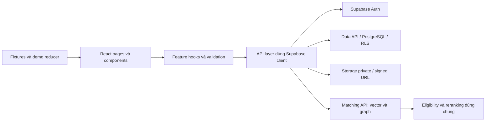

# Kế hoạch code UI, backend và thuật toán — Developer B

Cập nhật 15/10/2026. Phạm vi: Auth chung, Buyer, matching dùng chung, Admin demo; phối hợp Dev A ở Farmer/Carrier. Inventory màn hình chi tiết nằm trong [kế hoạch Dev B](dev-b-plan.md); contract dữ liệu chính xác nằm trong [database schema](database-schema.md).

Trạng thái triển khai 15/10/2026: ứng dụng React/Vite, Auth, Buyer CRUD, tìm lô theo quy tắc, Admin/Buyer demo, core matching và test đã có trong `src/`. Migration hybrid đã áp trên Supabase; Edge Function và Python embedding service/worker đã có mã nhưng chưa triển khai lên host. Vì vậy app vẫn mặc định `rule-only`. Xem [README](../README.md) để chạy và biết giới hạn kiểm thử hiện tại. Các mục bên dưới giữ vai trò tiêu chí nghiệm thu và backlog còn lại, không phải tuyên bố đã hoàn tất toàn bộ.

Hướng matching đã được người dùng đổi sang [vector + graph + điều kiện giao dịch](vector-graph-matching-plan.md). Plan đó là thiết kế triển khai hiện hành cho matching. Mục 5 bên dưới giữ công thức theo luật để làm baseline/fallback, không còn là toàn bộ hệ thống tìm kiếm. UI/CRUD/Auth trong tài liệu này vẫn áp dụng.

## 1. Điểm xuất phát và đầu ra

Đã có: Supabase project `yyslykqpamnlqkvutrlm`, 12 bảng/RLS, catalog, bucket ảnh private, Supabase client và cấu hình team. Đã seed 6 hồ sơ, 6 lô, 5 nhu cầu, 3 xe; 95 kiểm tra database local đạt. Các hồ sơ seed chưa có mật khẩu đăng nhập. Chưa có scaffold React/Vite, router, màn hình, API layer nghiệp vụ hoặc thuật toán matching.

Đầu ra quan trọng đầu tiên: Buyer đăng nhập thật → lưu hồ sơ → tạo nhu cầu → refresh vẫn còn → tìm lô PUBLISHED → xem điểm phù hợp và lý do → xem chi tiết/ảnh hợp lệ. Sau đó hoàn thiện các màn demo theo PDF.

| Nhóm | Mức thực hiện |
| --- | --- |
| Auth/session, hồ sơ Buyer, nhu cầu, tìm lô, chi tiết/ảnh, matching | Dữ liệu thật qua Supabase và quyền hiện có |
| Đăng ký/OTP | Bỏ OTP và đăng ký demo theo quyết định 15/10/2026; dùng tài khoản cấp sẵn |
| Dashboard tổng hợp, lời mời, chat, thỏa thuận, vận chuyển, đánh giá | Fixtures/state demo có nhãn, có thể reset |
| Admin danh sách/chi tiết/bản đồ/thao tác quản lý | Demo; đăng nhập theo role ADMIN, dữ liệu quản lý là fixtures |
| Settings/chính sách/giá/thanh toán | Placeholder theo Scope; không phát sinh giao dịch |

## 2. Kiến trúc triển khai



- UI theo stack TDD: React + TypeScript + Vite + Tailwind + React Router. Chọn phiên bản tương thích khi dựng scaffold và khóa trong lockfile. Bổ sung scripts dev/build/preview vào package hiện có, giữ scripts Supabase.
- Backend dùng Supabase Auth, Data API, PostgreSQL constraints/triggers/RLS và Storage; phần search bổ sung Edge Function điều phối, RPC và embedding worker/service theo plan vector/graph. Các file `*.api.ts` là lớp gọi backend từ frontend.
- Dùng một Supabase client, một router gốc và một bộ component nền. Auth Context quản lý phiên; state form đặt trong feature; demo dùng reducer có reset. Chưa cần thêm global store phức tạp.
- Component không gọi Supabase rải rác. Luồng thống nhất: page → hook/service → API → adapter/validator → dữ liệu UI.
- Sinh `Database` TypeScript types từ schema và dùng cho client. Input nghiệp vụ dùng kiểu riêng để không cho form truyền owner/role/timestamps tùy ý. TypeScript không thay validation dữ liệu runtime.
- Khi cần thao tác nhiều bảng nguyên tử hoặc matching vượt quy mô client: thêm migration/RPC có phạm vi rõ. RPC mặc định theo quyền caller và RLS; không thêm quyền rộng chỉ để làm màn hình chạy.

Tài liệu triển khai: [Vite](https://vite.dev/guide/), [React Router](https://reactrouter.com/start/declarative/installation), [Supabase generated types](https://supabase.com/docs/guides/api/rest/generating-types). RLS thực thi quyền ở database, độc lập với route guard trên UI: [Supabase RLS](https://supabase.com/docs/guides/database/postgres/row-level-security).

## 3. Plan UI

### UI-01 — Nền giao diện và Auth

1. Lấy token màu/chữ/khoảng cách từ `Description/Buyer.pdf` và `Admin.pdf`: Buyer sidebar xanh đậm, nền kem, card sáng, nút xanh/vàng; Admin dùng header/tab theo PDF. Dev A điều phối theme chung; Dev B cung cấp yêu cầu Buyer/Admin và chỉ sửa file tích hợp sau khi thống nhất ownership.
2. Component chung: Button, Input, Select, DateRange, Modal, Tabs, Badge, Table, Pagination, Loading, EmptyState, ErrorState, DemoBadge. Có label, focus bàn phím, đóng modal bằng Escape, trả focus về nút mở và thông báo lỗi cạnh trường.
3. Layout: BuyerLayout, AdminLayout; sidebar Buyer chuyển drawer trên mobile; điều hướng sửa đúng nhãn Buyer dù PDF có vài nhãn Farmer tái sử dụng.
4. AuthProvider, RoleGuard, màn pending-role/forbidden/not-found. Chờ tải session và profile xong mới redirect; lỗi mạng tải profile phải có retry, không coi là chưa đăng nhập. Xóa dữ liệu cache theo user khi logout/đổi tài khoản.
5. Login SĐT/password bằng tài khoản cấp sẵn theo TDD. Quyết định 15/10/2026: bỏ OTP và đăng ký demo do chưa có tài nguyên SMS. Tài khoản test đăng nhập được phải chuẩn bị riêng, không dùng 6 placeholder seed như tài khoản có mật khẩu.

### UI-02 — Hồ sơ và nhu cầu Buyer

| Route | Công việc | Điều kiện nghiệm thu |
| --- | --- | --- |
| `/buyer/profile` | Form tên cá nhân, tổ chức, tỉnh, địa chỉ | Tải đúng account; cập nhật và đọc lại đúng |
| `/buyer/requests` | Danh sách của mình, lọc trạng thái, xem/sửa/đóng/hủy | Không xuất hiện nhu cầu Buyer khác; empty/loading/error đủ |
| `/buyer/requests/new` | Form nhiều nhóm + preview theo Buyer trang 5 | Mọi trường giữ trong form đều lưu được |
| `/buyer/requests/:id/edit` | Tải dữ liệu, cập nhật, công bố nháp | Refresh không mất bản ghi; owner sai không sửa được |

Nhóm form: loại/giống quả, phân loại, tổng khối lượng, lượng tối thiểu mỗi lô, cho phép đáp ứng một phần, giá min/max, ngày bắt đầu/kết thúc, tỉnh/huyện ưu tiên, chất lượng, đóng gói, cách thu mua, vận chuyển và ghi chú. UI nhập tấn, lưu kg; giá lưu VND/kg; date giữ `YYYY-MM-DD`.

`DRAFT` hiện vẫn phải đầy đủ các trường bắt buộc của DB. Form dở dang được giữ trong state khi báo lỗi; không quảng bá autosave chưa triển khai. Nút gửi khóa khi đang lưu; API chỉ báo thành công sau khi server trả bản ghi. Request tạo mới dùng UUID ổn định cho một lần submit để khi mạng timeout có thể kiểm tra bản ghi trước khi thử lại, tránh tạo trùng.

Đề xuất UX trạng thái: DRAFT → OPEN/CANCELLED; OPEN → CLOSED/CANCELLED; CLOSED/CANCELLED chỉ xem trong MVP. DB hiện chỉ kiểm tra enum, chưa cưỡng chế các chuyển trạng thái này. Nếu cần đây là bất biến nghiệp vụ thì bổ sung trigger/RPC và test bằng migration mới trước khi gọi là được BE bảo đảm.

### UI-03 — Tìm lô và matching

- `/buyer/lots?requestId=...`: chọn nhu cầu của mình, bộ lọc, sắp xếp, card kết quả, tổng số, phân trang; giữ filter/request/page trong URL để back/refresh đúng ngữ cảnh.
- Card có loại/giống, tỉnh, lượng, giá, ngày, nhà vườn qua `marketplace_profiles`, ảnh hoặc placeholder, điểm phù hợp và lý do chính.
- Điểm luôn gắn với nhu cầu đang chọn. Chưa chọn nhu cầu thì cho duyệt lô, không gắn điểm ngẫu nhiên. Preview nhu cầu DRAFT ghi rõ; CLOSED/CANCELLED không dùng để khởi động tìm đối tác trong MVP.
- Modal chi tiết đọc lại lô bằng ID và policy hiện tại; lô vừa đóng hoặc không còn quyền đọc thì báo không còn khả dụng. Không chèn địa chỉ/SĐT/GPS giả vào chi tiết lô thật.
- Ảnh private lấy signed URL TTL ngắn, xử lý lỗi/hết hạn bằng tải lại khi cần; seed hiện chưa có ảnh nên phải có placeholder. A cung cấp ít nhất một lô có upload thật để kiểm thử đường ảnh.
- Kết nối/chuyển chat đi vào luồng demo có nhãn và giữ lotId/requestId làm ngữ cảnh.

### UI-04 — Buyer demo và Admin

- Buyer dashboard; lời mời/kết nối; chat ba cột; trả giá/hẹn khảo sát/xác nhận; yêu cầu vận chuyển; đánh giá. Fixture liên kết nhất quán theo hội thoại/lô/nhu cầu và reducer xử lý các hành động có thể reset.
- Admin dashboard, Buyers/Farmers/Carriers, bản đồ mẫu, marketplace, connections/transport và placeholders. Danh sách có tìm kiếm, filter, phân trang, modal xem/sửa/xóa fixture; không gọi API xóa tài khoản thật.
- Thay vùng hiển thị mật khẩu trong PDF Admin bằng trạng thái/mã tài khoản. Không hiển thị mật khẩu.
- Map/timeline/tracking/chỉ số mô phỏng có nhãn. Không tính khoảng cách km từ tên tỉnh, không tự tích hợp GPS hoặc IoT.
- Kiểm tra 390px, 768px, 1440px; ưu tiên form một cột, modal vừa màn, chat chuyển từng panel, bảng cuộn trong vùng riêng.

## 4. Plan backend và data access

Tên hàm dưới đây là contract TypeScript dự kiến, không phải endpoint đã tồn tại.

| Module | Hàm / tác vụ | Bảng và quyền |
| --- | --- | --- |
| `auth` | signIn, signOut, loadCurrentProfile, theo dõi session | Auth + profile chính chủ; role từ DB |
| `catalog` | listFruitTypes, listVarieties | Danh mục active cho user đăng nhập |
| `buyer-profile` | getMyBuyerProfile, saveBuyerProfile, updateDisplayName | `buyer_profiles`, cột cho phép của `profiles` |
| `buy-requests` | listMine, getMine, create, update, changeStatus | Owner = Auth ID, payload cập nhật không có owner/id/role |
| `lots` | browsePublished, getPublishedLot, listImageLinks | `lots`, `lot_images`, quyền Buyer PUBLISHED |
| `marketplace` | getMarketplaceProfiles(ids) | Tên/tỉnh an toàn, lấy theo batch ID, không đọc hồ sơ riêng |
| `matching` | loadBuyerCandidates, rankLotsForRequest | Đọc đúng tập ứng viên; score thuần TS |
| `matching` dùng bởi A | loadFarmerCandidates, rankRequestsForLot | Lô của Farmer + nhu cầu OPEN; cùng score function |
| `images` | getSignedImageUrls(paths), refresh khi hết hạn | Storage API với session hiện tại |

Trình tự backend:

1. Sinh types, adapter numeric/date, kiểu lỗi thống nhất; kiểm tra schema đang có thay vì thêm bảng lặp.
2. Hoàn thiện session/profile và 2 tài khoản Buyer đăng nhập được để test đọc chéo; thêm Farmer/Carrier/Admin cho kiểm thử liên vai trò. Quy trình quản trị cấp role, không có nút tự cấp role trong app.
3. API hồ sơ và nhu cầu; validation runtime; trả lỗi riêng cho mất phiên, validation, không có quyền/không tồn tại và lỗi mạng. Update cần trả bản ghi: 0 dòng không phải lưu thành công.
4. Hai bảng profile cá nhân và Buyer được lưu bằng hai thao tác tách biệt có thông báo riêng. Nếu UX bắt buộc một nút lưu nguyên tử, thêm RPC trong migration mới; không giả định hai HTTP request là một transaction.
5. API tìm lô/ảnh/identity; batch identity và image links để tránh một request cho mỗi card. Chỉ cấp signed URL cho ảnh cần hiển thị.
6. Matching data loader lấy đủ tập ứng viên theo mục 5; cache theo user/role/request/filter/ruleVersion, invalidate khi nhu cầu thay đổi. Bỏ response cũ khi người dùng đổi filter hoặc đăng xuất.
7. Kiểm thử HTTP thực với session đúng vai trò: login, CRUD, RLS, upload do A triển khai, ký URL và đọc ảnh. 95 test SQL hiện có không thay kiểm thử HTTP này.

Phần CRUD chưa cần server Express/Nest hoặc ORM riêng. Matching mới cần Edge Function/RPC và embedding worker/service theo plan vector/graph; các contract loader/ranking phía trên được hiện thực qua endpoint dùng chung, không tải toàn bộ corpus vào trình duyệt. Các thao tác demo không tạo bảng chat/orders/bookings.

## 5. Matching theo luật — baseline và fallback cho phương án vector/graph

Phần này giữ để so sánh và xử lý khi inference lỗi. Trọng số hybrid, graph traversal, candidate retrieval, model version và scope xếp hạng tuân theo [plan vector/graph](vector-graph-matching-plan.md). Mục 5.4 là cách nạp dữ liệu của baseline client, được thay bằng truy hồi backend khi chạy hybrid.

Trọng số 40/35/25 kế thừa đề xuất trong plan cũ; công thức chi tiết dưới đây là đề xuất mới, chưa phải quyết định đã duyệt trong TDD. Lưu `ruleVersion = "v1-proposed"` và các ngưỡng trong config để có thể thay đổi kèm test. Điểm biểu thị mức phù hợp theo luật, không phải xác suất giao dịch thành công.

### 5.1 Chuẩn hóa và loại ứng viên

`evaluateEligibility(lot, request)` trả `eligible`, danh sách `exclusionReasons` và `warnings`.

Loại ứng viên khi:

1. Lô không PUBLISHED. Phía Farmer chỉ xếp nhu cầu OPEN; phía Buyer được preview nhu cầu DRAFT của mình với nhãn rõ.
2. Khác `fruit_type_id`.
3. Nhu cầu chỉ định `variety_id` nhưng lô thiếu hoặc khác giống — đề xuất giống là điều kiện bắt buộc.
4. Khoảng ngày không giao nhau. Hai khoảng đóng giao khi `harvest_start <= required_end && harvest_end >= required_start`; cùng ngày biên vẫn tính giao.
5. Có `min_lot_quantity_kg` và lô nhỏ hơn mức đó.
6. `allow_partial=false` và lượng lô nhỏ hơn `target_quantity_kg`.
7. Thiếu/không hợp lệ dữ liệu cốt lõi: fruit ID, quantity, price, dates, target hoặc khoảng giá. Trả lý do thay vì cho NaN đi vào score.

Filter người dùng chủ động bật như tỉnh, giá tối đa, grade, chứng nhận là điều kiện loại riêng của lần tìm kiếm. Khi chưa bật filter, `preferred_provinces` là ưu tiên mềm theo điểm khu vực. Grade/chất lượng/đóng gói/hình thức mua bán được so sánh và hiển thị phù hợp/chưa đáp ứng/chưa rõ; không ngầm coi chứng nhận tự khai là đã xác minh. Hiển thị rõ điểm v1 chỉ xét giá/lượng/tỉnh để người dùng không hiểu điểm cao là đạt toàn bộ yêu cầu.

### 5.2 Chấm điểm

Ký hiệu: `p` = giá lô, `[a,b]` = khoảng giá nhu cầu, `q` = lượng lô, `Q` = tổng lượng cần mua; `clamp(x)=min(1,max(0,x))`.

**Giá — tối đa 40 điểm**

```text
nếu a <= p <= b: P = 1
nếu p < a:      P = clamp(1 - (a - p) / (0.20 * a))
nếu p > b:      P = clamp(1 - (p - b) / (0.20 * b))
```

Ngoài khoảng giá vẫn có thể được gợi ý với nhãn “Giá ngoài khoảng — cần thương lượng”; không gắn “đáp ứng giá”. Lệch 20% trở lên so với biên tương ứng được 0 điểm giá. Ngưỡng 20% là tham số đề xuất; không chia cho `b-a`, nên khoảng giá cố định `a=b` vẫn hợp lệ. Không dùng giá sàn riêng nhà vườn để tính điểm Buyer.

**Khối lượng — tối đa 35 điểm**

```text
Qscore = min(q / Q, 1)
contributionKg = min(q, Q)
remainingKg = max(Q - q, 0)
excessKg = max(q - Q, 0)
```

Lô đáp ứng một phần vẫn được xếp hạng nếu qua điều kiện ở trên. `remainingKg` chỉ là phần thiếu khi xét riêng cặp này; không phải tồn dư của một đơn đã đặt. Nếu lô dư lượng hoặc hình thức bán không rõ việc chia lô, hiển thị cần thống nhất khối lượng; không hứa người bán đã đồng ý bán một phần.

**Khu vực — tối đa 25 điểm**

- Danh sách tỉnh ưu tiên rỗng: `L=1`, lý do “Không giới hạn tỉnh”.
- Tỉnh lô có trong danh sách: `L=1`.
- Tỉnh ngoài danh sách hoặc chưa có: `L=0`, phân biệt lý do “Ngoài tỉnh ưu tiên” / “Chưa rõ tỉnh”. Không tự cộng điểm cho tỉnh lân cận.
- Chuẩn hóa tên tỉnh theo danh mục dùng chung; unknown không đoán. Chưa chấm điểm huyện hoặc khoảng cách.

```text
rawScore = 40 * P + 35 * Qscore + 25 * L
score hiển thị = round(rawScore, 2)
```

Không tự chia lại trọng số khi thiếu tỉnh. Tie-break: rawScore giảm dần → lot ID tăng dần (phía Buyer), hoặc request ID tăng dần (phía Farmer). Tính từ cùng input/config phải ra cùng kết quả; không dùng random hoặc giờ hiện tại trong score.

`MatchResult`: lotId, requestId, eligible, score, breakdown, reasons, warnings, exclusionReasons, contributionKg, remainingKg, excessKg, ruleVersion. Tách mã lý do và bản dịch tiếng Việt khỏi phép tính.

### 5.3 Kiểm tra bằng dữ liệu đã seed

| Nhu cầu / lô | Kỳ vọng theo v1 đề xuất |
| --- | --- |
| Ri6 50 tấn / Ri6 15 tấn, giá 65.000 trong 60.000–70.000, đúng tỉnh | 75,50 điểm; đóng góp 15 tấn, còn thiếu 35 tấn |
| Mít 12 tấn / mít 8 tấn, giá 14.000 trong 12.000–18.000, đúng tỉnh | 88,33 điểm; còn thiếu 4 tấn |
| Thanh long 20 tấn / lô 10 tấn, đúng giá và tỉnh | 82,50 điểm; còn thiếu 10 tấn |
| Ri6 15–20/11 / các lô hiện tại | Không có lô hợp lệ do ngày/trạng thái |
| Nhu cầu Ri6 / lô Monthong | Bị loại do giống |
| Lô DRAFT hoặc CLOSED | Không được đưa vào kết quả Buyer |

File `verify-demo.sql` hiện kiểm tra một tập điều kiện ứng viên đơn giản; nó chưa tính các điểm ở bảng này và không thay test thuật toán v1.

### 5.4 Lấy ứng viên, xếp hạng, phân trang

1. Push các điều kiện loại phù hợp xuống query Supabase: PUBLISHED, fruit, optional variety, giao ngày, lượng tối thiểu và filter người dùng. Thuật toán thuần vẫn kiểm tra lại để dùng độc lập được.
2. Mặc định đề xuất tối đa 1.000 ứng viên/lần match. Lấy theo batch 200, thứ tự UUID ổn định với cursor, kiểm tra thêm bản ghi thứ 1.001. Không chỉ đọc một trang API mặc định rồi kết luận đã lấy hết.
3. Khi vượt giới hạn: báo cần thu hẹp bộ lọc; không công bố top toàn tập từ một phần dữ liệu. Nếu nhu cầu thực tế thường vượt ngưỡng, chuyển score/ranking sang RPC và kiểm thử tương đương TS trước khi mở rộng.
4. Khi đã lấy đủ tập trong giới hạn: đánh giá N cặp → xếp toàn bộ → phân trang 12 kết quả. Đổi request/filter thì reset trang 1; đổi sort vẫn áp trên cả tập đã nạp.
5. Batch đọc qua nhiều HTTP request không phải snapshot transaction: ghi thời điểm tải, cho refresh và đọc lại chi tiết trước khi tương tác. MVP không đặt chỗ hay bảo đảm tồn kho từ điểm match.

Độ phức tạp: chấm điểm O(N), sort O(N log N), bộ nhớ O(N). Cùng một `scoreMatch` dùng cho Buyer và Farmer; chỉ khác loader và đối tượng được xếp hạng.

## 6. Các thuật toán hỗ trợ cần code

| Thuật toán/quy tắc | Cách triển khai | Test quan trọng |
| --- | --- | --- |
| Chuẩn hóa khối lượng | Parse số thập phân rõ định dạng; tấn → kg, tối đa 3 chữ số thập phân kg; không âm/0/NaN | 0,5 tấn → 500 kg; input mơ hồ/thừa precision phải báo lỗi |
| Chuẩn hóa tiền | Số nguyên VND/kg trong giới hạn DB/JS; format bằng locale | 65.000 hiển thị tương ứng 65000; không âm, không mất chữ số |
| Khoảng ngày | Validate ngày lịch và start <= end; so ISO date hoặc số ngày UTC | Ngày giao biên, tháng/năm nhuận, tránh lệch múi giờ |
| Enum/danh mục | ID loại/giống; mã đóng gói chung; trim, bỏ phần tử rỗng/trùng | Đổi loại quả reset giống không hợp lệ |
| Tìm kiếm/filter | Debounce khoảng 300ms; lọc trước phân trang; hủy/bỏ response cũ | Gõ nhanh, đổi request giữa lúc tải, back/refresh URL |
| Phân trang | Thứ tự ổn định, reset/clamp page theo tập kết quả | Xóa/đóng bản ghi cuối trang, trang vượt số lượng |
| Trạng thái form | dirty/submitting/success/error; UUID cho retry create | Double click, timeout đã ghi thành công, giữ input khi lỗi |
| Demo workflow | Reducer nhận event, transition whitelist, reset fixture | Chat → trả giá → xác nhận → vận chuyển, không nhảy bước vô lý |

Vector search và graph là hạng mục hiện hành theo plan bổ sung. Chưa cần tự huấn luyện model/GNN, clustering, tối ưu tuyến xe hoặc thuật toán gom nhiều lô. Nếu sau MVP có yêu cầu gom đủ lượng với chi phí thấp nhất, đó là bài toán riêng cần tồn kho/giữ hàng, chi phí vận chuyển, ràng buộc chia lô và mục tiêu tối ưu rõ trước khi chọn greedy/knapsack/min-cost flow.

## 7. Cấu trúc code dự kiến

```text
src/
  app/                  router, providers, app shell
  components/ui/        component nền dùng chung với A
  layouts/              BuyerLayout, AdminLayout
  lib/                  supabase.ts hiện có, format/error helpers
  types/                database.types.ts được sinh từ schema
  features/
    auth/               provider, guards, pages, api
    catalog/            api, danh mục và adapter chung
    buyer-profile/      pages, form, api, validation
    buy-requests/       pages, components, api, hooks, validation
    lots/               Buyer browse/detail, api, images
    matching/           types, config, eligibility, score, rank, loaders, tests
    demo/               fixtures, reducer, DemoBadge/reset
    buyer-demo/         dashboard, negotiations, transport, reviews
    admin/              pages và fixture adapters
docs/
  code-implementation-plan.md
  data-contract.md      tạo khi bắt đầu implementation
  acceptance-checklist.md
```

Không tách thành nhiều app/package ở MVP. Hàm matching không import React hoặc Supabase để Dev A dùng và test độc lập. Folder Farmer/Carrier do A điều phối; B không tạo bản sao.

## 8. Backlog, thứ tự và mốc bàn giao

Ước tính cũ 11–14 ngày áp dụng khi matching chỉ theo luật. Với vector/graph, thay B4 bằng chuỗi M0–M6 khoảng 8–13 ngày; tổng Dev B ước tính khoảng 18–25 ngày làm việc, gồm benchmark và tích hợp. A phối hợp scaffold/dữ liệu; chờ hosting/tài khoản hoặc thay scope không tính vào số ngày code. CRUD/UI có thể bàn giao trước khi hoàn tất hybrid.

| Thứ tự | Phần việc | Ước lượng | Đầu ra nghiệm thu / phụ thuộc |
| --- | --- | --- | --- |
| B0 | Contract với A, scaffold/theme/router | 0,5–1 ngày | App chạy, ownership rõ, route/component chung; dùng package/client hiện có |
| B1 | Auth UI + provider/guard + types/API nền | 1–1,5 ngày | Login/logout, pending/error đúng; cần tài khoản đăng nhập được |
| B2 | Hồ sơ Buyer + nhu cầu CRUD/preview | 2 ngày | Lưu và refresh đúng; Buyer A/B không truy cập chéo |
| B3 | Browse/filter/detail/ảnh | 1–1,5 ngày | Dữ liệu Supabase thật, đủ empty/error; cần ảnh do A upload |
| B4 | Vector + graph + reranking, theo M0–M6 của plan bổ sung | 8–13 ngày | Search API, embedding pipeline, benchmark, UI lý do và tích hợp A |
| B5 | Buyer dashboard/chat/transport/reviews demo | 2 ngày | Luồng demo liên kết, responsive và reset được |
| B6 | Admin theo PDF + Scope | 1,5–2 ngày | Các nhóm quản lý/demo và placeholders đủ, không lộ mật khẩu |
| B7 | Tích hợp A, HTTP/E2E, rà UI, tài liệu | 1–2 ngày | Build/typecheck đạt; kết quả nghiệm thu và hạn chế được ghi |

Mỗi hàng là một nhóm thay đổi có thể review riêng, chia commit nhỏ khi thực hiện. Bàn giao module matching/contract ngay sau B4 để A tích hợp trong lúc B làm demo. Nhánh làm việc hiện tại `Linh`; plan này chưa tạo commit hoặc push.

## 9. Kiểm thử và tiêu chí xong

- Unit tập trung vào scoring, eligibility, money/quantity/date, stable tie, missing data, `allow_partial`, giới hạn ứng viên và retry tạo nhu cầu; không chỉ test chi tiết JSX.
- Database: giữ bộ 95 kiểm tra hiện có; thêm test chỉ khi thay migration/policy/constraint. Các RLS hiện tại phải tiếp tục pass.
- HTTP: account thật login → đọc profile → CRUD nhu cầu → reload; session Buyer khác không đọc/sửa được; Farmer đọc OPEN; Carrier không truy cập Buyer; private floor không xuất hiện; ảnh private ký URL đúng quyền.
- UI/E2E: chọn nhu cầu → lọc → điểm/lý do → chi tiết; không kết quả; lỗi mạng; hết phiên; truy cập sâu qua URL; logout giữa lúc tải; responsive/modal/keyboard. Demo không thông báo đã gửi thật cho đối tác.
- Baseline regression dùng ba cặp seed có điểm kỳ vọng 75,50 / 88,33 / 82,50; hybrid có benchmark riêng về candidate recall/NDCG, hard constraints, freshness, fallback và HNSW so với exact theo plan bổ sung. Không dùng điểm baseline làm kết quả kỳ vọng hybrid.
- Release: typecheck + production build, mở lại các deep link trên môi trường đích, không secret trong bundle, docs setup/contract/giới hạn đầy đủ. Kết quả 95 test hiện tại không được dùng để tuyên bố UI đã nghiệm thu.

Các giả định cần giữ rõ khi bắt đầu code: trọng số/ngưỡng matching là cấu hình đề xuất; giống là điều kiện bắt buộc khi đã chọn; OTP/đăng ký demo đã bỏ, Admin vẫn demo; date seed cố định tháng 10–11/2026; A sở hữu Farmer/Carrier và điều phối scaffold. Có thể triển khai nền UI/API theo plan trong khi các quy tắc matching còn được review.
