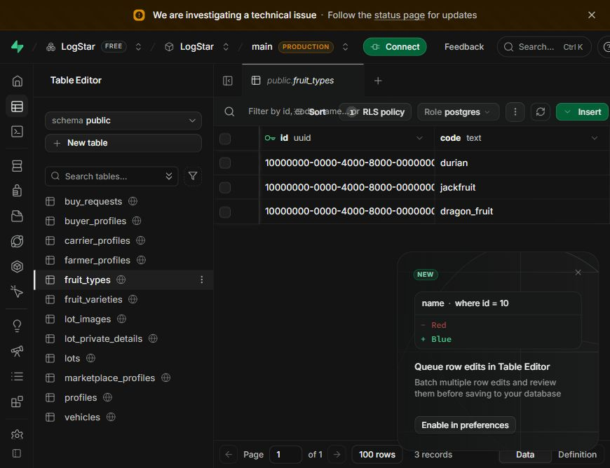

# Biên bản triển khai database LogStar

Ngày: 14/10/2026 (Asia/Bangkok).

## Project và phạm vi

- Project: **LogStar**, ref `yyslykqpamnlqkvutrlm`.
- [Supabase Table Editor](https://supabase.com/dashboard/project/yyslykqpamnlqkvutrlm/editor).
- Database: `postgres`, PostgreSQL **17.11**.
- Trước khi chạy: không có bảng ứng dụng trong public/logstar_private, không có type trùng tên, policy Storage, bucket lot-images, trigger Auth tùy chỉnh hoặc account Auth.
- Migration: `supabase/migrations/202610140001_initial_schema.sql` và catalog `supabase/seed.sql`, ghép thành một transaction trong `supabase/deploy.sql`.
- SHA-256 gói deploy đã dùng: `B2F1EE1F535BA440C104061789890CD8282351278D32B4B05599E8FD18D7AEB8`.
- Cách áp dụng: Supabase SQL Editor, thực thi thành công. Editor cũng được yêu cầu bật RLS cho các bảng mới; migration vốn đã bật RLS cho toàn bộ bảng.

## Kết quả xác minh trực tiếp

| Hạng mục | Kết quả |
| --- | --- |
| Bảng ứng dụng | 12 |
| Bảng đã bật RLS | 12/12 |
| Catalog | 3 loại quả, 5 giống; tên tiếng Việt đúng |
| Bucket ảnh | `lot-images`, private |
| Giới hạn ảnh | 5,242,880 bytes; JPEG, PNG, WebP |
| Trigger Auth | `logstar_auth_user_created` tồn tại |
| Grants bảng cho anon/PUBLIC | 0 |
| SECURITY DEFINER thiếu search_path an toàn | 0 |
| Account Auth sau kiểm tra | 0 |
| Lô test còn sót | 0 |
| Data API | public và graphql_public; logstar_private không được expose |

12 bảng: `profiles`, `farmer_profiles`, `buyer_profiles`, `carrier_profiles`, `marketplace_profiles`, `fruit_types`, `fruit_varieties`, `lots`, `lot_private_details`, `buy_requests`, `vehicles`, `lot_images`.

Catalog: sầu riêng (Ri6, Monthong), mít (Mít Thái), thanh long (ruột đỏ, ruột trắng). Đây là danh mục khởi tạo có thể thay đổi bằng migration/seed tiếp theo.

## Kiểm thử

- 90 kiểm tra cục bộ đạt với PostgreSQL/PGlite, bao gồm gói deploy và script xác minh cloud.
- `supabase/tests/cloud-smoke.sql` được chạy trực tiếp trên database Supabase. Kết quả: **PASS: 16 security checks; all temporary fixtures rolled back**.
- Những ca cloud gồm metadata không thể nâng role, giới hạn profile theo chủ sở hữu, Buyer chỉ thấy PUBLISHED, không thấy giá sàn/hồ sơ Farmer riêng, đọc được marketplace identity tối thiểu, chặn sửa role/owner, chặn khối lượng âm, Buyer khác không đọc/sửa nhu cầu, Farmer thấy lô mình và nhu cầu OPEN, kiểm tra thư mục upload và giá sàn.
- Script dùng subtransaction rollback để loại bỏ toàn bộ fixtures và Auth claims; đã truy vấn lại để xác nhận không còn account/lô test.

## Giới hạn xác minh và cách tiếp tục

Chưa tạo account demo có mật khẩu, chưa có React app hoặc `.env` client. Các bài test cloud dùng role PostgreSQL và JWT claims giả lập để kiểm tra database, không phải đăng nhập HTTP thực.

Dev B tiếp tục Auth/session và nhu cầu Buyer; Dev A dùng chung schema cho Farmer/Carrier. Thực hiện login, upload/signed URL qua SDK và test luồng người dùng khi có client. Xem [schema và API contract](database-schema.md) trước khi viết payload để dùng đúng cột, đơn vị và quyền.

Migration được áp qua SQL Editor nên chưa ghi vào migration history của Supabase CLI. Trước khi dùng CLI `db push` ở project này, reconcile initial migration đã áp dụng; không chạy lại gói deploy. Không cần tạo lại các bảng hiện có.

