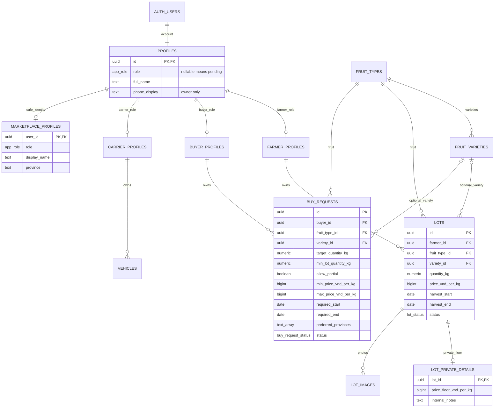

# LogStar - Database schema v1

Ngày thiết kế: 14/10/2026. Project đích: `yyslykqpamnlqkvutrlm`.

**Trạng thái triển khai:** đã tạo và xác minh trên Supabase project LogStar `yyslykqpamnlqkvutrlm` ngày 14/10/2026. Có 12 bảng ứng dụng bật RLS, bucket private và catalog. 90 kiểm tra cục bộ và 16 kiểm tra bảo mật trên cloud đạt; toàn bộ fixtures cloud được rollback. Xem [biên bản triển khai](database-deployment.md).

## 1. Phạm vi và nguồn sự thật

Schema hoàn thiện phần dữ liệu F của TDD v0.4 và form trong bộ thiết kế `Description/`. SQL trong `supabase/migrations/202610140001_initial_schema.sql` là định nghĩa chính xác của tên cột, kiểu, constraints, indexes, grants và RLS. `supabase/deploy.sql` được ghép tự động từ migration và seed, dùng cho cài đặt ban đầu trong SQL Editor.

Project Supabase đã có database PostgreSQL `postgres`, schema `auth` và `storage`. Cài đặt này tạo các bảng ứng dụng trong `public`, các hàm nội bộ trong `logstar_private`, và bucket ảnh riêng tư. Không tạo một Supabase project khác hoặc database PostgreSQL thứ hai.

Có 12 bảng ứng dụng: 9 bảng trong TDD và 3 bảng bổ sung cần thiết là `fruit_varieties`, `marketplace_profiles`, `lot_private_details`. Không có bảng chat, hợp đồng, đơn hàng, booking, thanh toán, GPS hoặc IoT vì các phần đó vẫn D/U/O.

## 2. Sơ đồ quan hệ

`auth.users`, `storage.buckets`, `storage.objects` là bảng hệ thống Supabase có sẵn, không nằm trong tổng 12 bảng ứng dụng. `lot_images.storage_path` liên kết logic tới object trong bucket, được trigger kiểm tra; không dùng foreign key vào cấu trúc nội bộ của Storage.

## 3. Danh mục bảng

Mọi bảng có `created_at`, `updated_at` kiểu `timestamptz`; timestamp do server tạo/quản lý. Khóa UUID. Role và ownership được ràng buộc ở DB, không phụ thuộc role trên UI.

| Bảng | Dữ liệu và kiểu quan trọng | Quy tắc |
| --- | --- | --- |
| `profiles` | `id` = Auth ID; `role` enum nullable; `full_name`, `phone_display` text | Chỉ chính chủ đọc. Browser chỉ sửa tên và SĐT hiển thị; SĐT này không thay số xác thực trong Auth |
| `farmer_profiles` | `user_id`; farm/province/district/address text; latitude/longitude numeric; area_m2, tree_count, orchard_age_years, annual_yield_kg; cultivated_varieties/certifications text[]; growing_area_code | Hồ sơ đầy đủ chỉ Farmer sở hữu. Chứng nhận tự khai báo, không được coi đã xác minh |
| `buyer_profiles` | `user_id`, organization_name, province, address | Buyer sở hữu. Không lộ địa chỉ riêng cho đối tác |
| `carrier_profiles` | `user_id`, company_name, province, address, service_provinces text[] | Carrier sở hữu |
| `marketplace_profiles` | `user_id`, role, display_name, province | Trigger tự đồng bộ từ hồ sơ domain. Không có SĐT, email, địa chỉ đường phố, GPS hoặc mật khẩu |
| `fruit_types` | UUID, code duy nhất, name, active | Catalog đọc sau đăng nhập; client không tự sửa |
| `fruit_varieties` | UUID, fruit_type_id, code, name, active | Mỗi giống thuộc một loại quả; composite FK ngăn chọn giống sai loại |
| `lots` | farmer_id, fruit_type_id/variety_id, title/grade; quantity_kg numeric(14,3); price bigint; harvest dates; province/district; growing_area_code; certifications/packaging_options text[]; selling_method; description/status | Farmer CRUD lô mình. Buyer chỉ đọc PUBLISHED. Nội dung mô tả/chứng nhận ở bảng này là thông tin công khai khi đăng |
| `lot_private_details` | lot_id, price_floor_vnd_per_kg bigint nullable, internal_notes | Chỉ chủ lô đọc/ghi; trigger bảo đảm giá sàn không cao hơn giá chào |
| `buy_requests` | buyer_id, fruit/variety, title/grade; target/min_lot kg; allow_partial; min/max price; required dates; preferred_provinces/districts; quality_requirements/packaging_options; buying_method, transport_by, notes/status | Buyer CRUD của mình; Farmer chỉ đọc OPEN. Notes là hướng dẫn thu mua công khai, không phải ghi chú riêng |
| `vehicles` | carrier_id, license_plate và normalized plate; vehicle_type, capacity_kg, provinces; min/max_temperature_c, active | Carrier CRUD của mình. Biển số chuẩn hóa không trùng trong cùng đội xe; không xây workflow xác minh chủ xe |
| `lot_images` | UUID, lot_id, storage_path duy nhất, sort_order 0..7 | File phải tồn tại trong đúng thư mục của chủ lô; tối đa tám vị trí ảnh/lô |

## 4. Quyết định dữ liệu và mapping UI

| UI | Cột DB/cách chuyển |
| --- | --- |
| Sầu riêng Ri6/Monthong | `fruit_type_id` = durian, `variety_id` = giống tương ứng; không tạo hai loại quả Sầu riêng riêng biệt |
| Loại A/B/C, xuất khẩu | `grade` text; danh mục hiển thị do team quản lý, chưa áp chuẩn chất lượng bên ngoài |
| Khối lượng form nhập tấn | Lưu kg trong `quantity_kg` hoặc `target_quantity_kg`; 50 tấn = 50000 kg |
| Tổng khối lượng cần gom | `target_quantity_kg`; không ép mọi lô ứng viên phải đạt đủ tổng nhu cầu |
| Khối lượng tối thiểu mỗi lô | `min_lot_quantity_kg` tùy chọn; không được vượt target |
| Chấp nhận một phần nhu cầu | `allow_partial`, mặc định true để phù hợp mockup lô 12/15/28 tấn cho nhu cầu 50 tấn |
| Giá mong muốn | `lots.price_vnd_per_kg`, số nguyên VND/kg |
| Giá sàn riêng nhà vườn | `lot_private_details.price_floor_vnd_per_kg`, không gửi trong query listing Buyer |
| Slider giá min/max Buyer | `min_price_vnd_per_kg`, `max_price_vnd_per_kg`, cả hai >0, min <= max |
| Nhiều tỉnh/huyện ưu tiên | `preferred_provinces`, `preferred_districts` text[]; rỗng nghĩa không giới hạn khu vực |
| VietGAP/GlobalGAP/Organic | `quality_requirements` hoặc `certifications` text[]; đều là thông tin khai báo |
| Đóng gói | `packaging_options` text[]; thống nhất mã UI như CARTON/PLASTIC_CRATE/BULK/VACUUM_SEALED trước khi nhập |
| Bán/mua xô, theo loại, gom lẻ, bao tiêu | `trade_method`: WHOLE_FARM / BY_GRADE / PARTIAL / OFFTAKE |
| Buyer điều xe, Farmer giao, xem xét sau | `transport_by`: BUYER / FARMER / UNDECIDED; chỉ là lựa chọn thông tin, chưa tạo booking |
| Ảnh lô | `lot_images` + Storage `lot-images`; không dùng public URL |

TDD minh họa khối lượng min/max và `province` đơn. Schema này dùng tên có nghĩa rõ hơn theo UI: target tổng, min mỗi lô, và array tỉnh ưu tiên. Đây là contract v1 cho A/B; không duy trì hai bộ cột cùng nghĩa. Không có khoảng cách km vì chưa có tọa độ công khai/geocoding.

Khối lượng dùng numeric(14,3), không chấp nhận NaN/Infinity hoặc <=0. Tiền bigint dương, giới hạn trong số nguyên an toàn JavaScript; phép tính tổng tiền lớn cần xử lý Decimal/BigInt phù hợp. Ngày thu hoạch/thu mua là `date`; thời điểm ghi nhận là `timestamptz`.

Các trường domain bắt buộc vẫn phải có khi lưu DRAFT. Nháp ở đây là bản ghi hợp lệ chưa công bố, không phải autosave form còn trống. Nếu muốn lưu nháp thiếu thông tin cần thêm migration/validation trạng thái riêng.

## 5. Trạng thái và quyền

- Role: FARMER, BUYER, CARRIER, ADMIN. NULL = chưa được cấp role. Một account có một role ở MVP.
- Lô: DRAFT -> PUBLISHED -> CLOSED hoặc CANCELLED. Nhu cầu: DRAFT -> OPEN -> CLOSED hoặc CANCELLED. Hiện enum xác nhận giá trị hợp lệ; không áp máy trạng thái cứng hoặc tự sinh trạng thái giao dịch.
- FK `(user_id, profile_role)` với role generated bảo đảm domain đúng role kể cả khi ghi bằng backend. Đổi role khi đã có domain data sẽ bị FK chặn, cần quy trình chuyển đổi riêng.
- Các bảng F bật RLS. Anon không có quyền table. Role ADMIN không tự có quyền xem/sửa toàn bộ dữ liệu thật; màn Admin dùng fixtures như TDD.

| Dữ liệu | Chủ sở hữu | Buyer khác | Farmer khác | Carrier/Admin |
| --- | --- | --- | --- | --- |
| Account/profile đầy đủ | Đọc/sửa các cột được phép | Không | Không | Không, trừ account của mình |
| Marketplace identity | Đọc của mình | Xem Farmer có lô PUBLISHED | Xem Buyer có nhu cầu OPEN | Đọc của mình |
| Lô + ảnh | Farmer CRUD của mình | Buyer đọc PUBLISHED | Chỉ Farmer chủ lô | Không |
| Giá sàn/notes nội bộ | Farmer chủ lô | Không | Không | Không |
| Nhu cầu | Buyer CRUD của mình | Không | Farmer đọc OPEN | Không |
| Xe/biển số | Carrier CRUD của mình | Không | Không | Chỉ Carrier chủ xe |
| Loại/giống quả | Các account đăng nhập đọc | Đọc | Đọc | Đọc |

Nguồn role đáng tin là `profiles.role`. Khi Auth tạo user, trigger chỉ đọc `raw_app_meta_data.app_role` do quản trị viên kiểm soát; bỏ qua role trong `raw_user_meta_data`. Nếu chưa được cấp role, tạo profile pending. Không thêm form tự chọn ADMIN hoặc endpoint tạo tài khoản quản trị.

## 6. Auth provisioning và API contract cho Dev A/B

1. Tạo account trong Supabase Auth bằng quy trình quản trị tin cậy, chọn phone/password theo TDD; không ghi mật khẩu vào repo.
2. Nếu tạo user qua Admin API, đặt `app_metadata: { app_role: 'FARMER' }` (hoặc BUYER/CARRIER/ADMIN) ngay lúc tạo. Trigger tạo profile đúng role.
3. Với user đã tạo và profile pending, quản trị viên kiểm tra đúng Auth UUID rồi cập nhật `public.profiles.role` trong SQL Editor. Đây là thao tác tin cậy, không gọi từ client. Thay metadata sau khi user đã tạo KHÔNG tự đổi role trong profiles.
4. User đăng nhập, tải profile của mình, rồi upsert hồ sơ domain đúng role. Trigger sinh marketplace identity an toàn.
5. Farmer tạo lô bằng Auth ID của mình. Buyer tạo nhu cầu bằng Auth ID của mình. DB vẫn kiểm tra ownership khi client truyền ID.

Query/API gợi ý:

- `profiles.select(...)`: chỉ trả profile account hiện tại. Update chỉ gửi `full_name`, `phone_display`; không gửi `role`, `id`, timestamps.
- Hồ sơ domain có thể `upsert({ user_id, ...businessFields }, { onConflict: 'user_id' })`. Không gửi generated `profile_role`/timestamps. Idempotent user_id được phép, đổi user_id bị trigger chặn.
- Tạo/sửa lots/requests dùng insert/update rõ ràng; payload cập nhật không gửi ID, owner hay timestamps.
- Danh sách Buyer: query `lots` PUBLISHED, rồi query `marketplace_profiles` theo các farmer ID để lấy tên/tỉnh an toàn. Không join private `farmer_profiles`/`profiles` để lấy tên.
- Matching phía Farmer: query `buy_requests` OPEN và `marketplace_profiles` theo buyer ID. Không đòi quyền đọc SĐT hay địa chỉ cá nhân.
- Matching vẫn tính TypeScript theo TDD. Database không tự đặt trọng số, chốt giao dịch, phân bổ lô hay lưu kết quả score.
- Xóa domain/account có cascade tới dữ liệu con. Không thêm nút xóa account thật trên Admin demo. Storage files không tự xóa khi xóa metadata hoặc lô; cần cleanup qua Storage API.

## 7. Ảnh và Storage

- Bucket `lot-images`: private, tối đa 5 MiB/tệp, MIME JPEG/PNG/WebP. Tên file kết thúc .jpg/.jpeg/.png/.webp.
- Đường dẫn chuẩn: `<auth-user-id>/<lot-id>/<unique-file-name>.jpg`.
- Thứ tự: tạo lô DRAFT hợp lệ -> upload file qua Storage API -> insert lot_images -> công bố lô.
- Có tối đa tám slot sort_order (0..7), mỗi slot duy nhất/lô. Nếu cần swap hai slot trong một transaction, defer unique constraint hoặc dùng RPC phù hợp; không đổi slot qua hai request gây trùng.
- Buyer chỉ xin signed URL của ảnh đã liên kết với lô PUBLISHED. Owner được đọc file trong thư mục của mình để preview/cleanup.
- Không hỗ trợ Storage upsert/overwrite. Thay ảnh: upload tên mới -> thêm link -> xóa link cũ -> xóa object cũ qua Storage API. Chọn slot mới hợp lệ hoặc thực hiện đổi link trong transaction phù hợp.
- Muốn xóa file phải xóa liên kết lot_images trước. Policy ngăn xóa object còn đang được tham chiếu.
- Signed URL đã cấp còn hiệu lực tới khi hết hạn dù lô đổi trạng thái. Dùng TTL ngắn (ví dụ 60 giây) và tạo mới khi cần; không coi signed URL là cơ chế thu hồi tức thời.
- Không insert/delete trực tiếp `storage.objects` từ ứng dụng; các bảng này chỉ được thao tác thông qua Storage API. Các thao tác vào storage.objects trong test là mô phỏng database, không phải ví dụ upload file.

## 8. Triển khai lên project Supabase

1. Đăng nhập/kết nối và xác nhận đúng project `yyslykqpamnlqkvutrlm`.
2. Chạy `supabase/preflight.sql` (read-only). Đọc các bảng/types/bucket hiện có và mọi policy Storage. Policy PERMISSIVE khác có thể cho phép truy cập bucket mới; phải đánh giá trước khi thêm policy của app.
3. Nếu có object trùng tên hoặc hệ thống cũ, dừng áp initial migration và viết migration tương thích; không drop/truncate hoặc ghi đè dữ liệu cũ.
4. Chạy `supabase/deploy.sql` một lần, toàn bộ file: schema + grants/RLS + bucket + catalog nằm trong một transaction. Lỗi làm rollback toàn bộ cài đặt.
5. Chạy `supabase/verify-deployment.sql`. Kỳ vọng 12 bảng RLS, 3 loại quả, 5 giống, bucket private, trigger Auth và không có account thiếu profile. Không có table grants cho anon/PUBLIC.
6. Bảo đảm `logstar_private` không nằm trong Exposed Schemas của Data API. Các hàm SECURITY DEFINER ở schema này chỉ hỗ trợ policy/trigger, search_path được cố định rỗng.
7. Ghi lại ngày, project, migration và kết quả kiểm tra. Nếu dùng Supabase CLI để quản lý sau khi đã cài qua SQL Editor, reconcile migration history đã áp dụng trước khi `db push`; không chạy initial migration lần thứ hai.

Catalog seed là danh mục mặc định có thể thay đổi theo scope: sầu riêng (Ri6/Monthong), mít (Mít Thái), thanh long (ruột đỏ/trắng). Seed rerun không ghi đè tên hoặc tạo duplicate. Không seed tài khoản, mật khẩu hoặc dữ liệu cá nhân thật.

## 9. Kiểm thử đã chuẩn bị

Chạy từ thư mục `supabase/tests`: `npm ci --ignore-scripts`, sau đó `npm test`.

Test dùng PGlite (PostgreSQL thực chạy in-memory), với stub tối thiểu cho auth/storage của Supabase. Migration, constraints, triggers, privileges và RLS được chạy thật bằng các role PostgreSQL. Không mô phỏng HTTP Auth/Storage, gửi SMS hoặc sinh signed URL thực.

Hiện 90 kiểm tra đạt trên gói deploy: role escalation/metadata spoofing, ownership, đọc chéo đúng quyền, bảo vệ private floor, giá/ngày/NaN/variety, Buyer form, standard profile upsert, timestamp server, biển số/nhiệt độ, Storage folder/link/delete, catalog seed lặp, câu truy vấn xác minh triển khai, cấu hình SECURITY DEFINER và kịch bản kiểm tra cloud có rollback.

Đã kiểm chứng trực tiếp trên cloud: migration chạy với schema hệ thống thực, 12 bảng/RLS, grants, trigger Auth, catalog/bucket và 16 kiểm tra quyền dùng role PostgreSQL cùng Auth claims giả lập. Script `supabase/tests/cloud-smoke.sql` không để lại tài khoản hoặc dữ liệu test. Data API expose `public`/`graphql_public`, không expose `logstar_private`.

Chưa nghiệm thu phần ứng dụng: đăng nhập Auth qua HTTP, upload thực, MIME/file-size enforcement ở Storage service, signed URL và UI end-to-end. Các việc này cần account demo và client ứng dụng; không nằm trong việc tạo schema/bảng đã hoàn thành.

Tài liệu kỹ thuật đối chiếu: [Supabase RLS](https://supabase.com/docs/guides/database/postgres/row-level-security), [Auth user management](https://supabase.com/docs/guides/auth/managing-user-data), [Storage access control](https://supabase.com/docs/guides/storage/security/access-control), [PGlite](https://pglite.dev/docs/).
