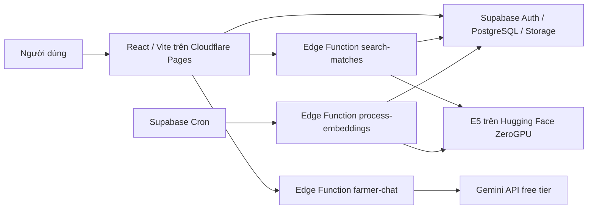

# Lộ trình deploy SmartFruit với ngân sách 0 đồng

Ngày đối chiếu tài liệu: 19/10/2026. Phạm vi: demo/MVP có kiểm soát, lưu lượng nhỏ. Đây là kế hoạch, chưa thực hiện deploy hoặc thay cấu hình tài khoản.

## 1. Kiến trúc đề xuất

Frontend hiện là ứng dụng tĩnh React/Vite, build ra `dist`. Không cần thêm VPS, Docker server hoặc backend Node cho các thao tác giao dịch. Dùng lại project Supabase đang vận hành; E5 chạy ngoài Edge runtime. Không thay model E5-base 768 chiều hoặc schema vector để chuyển host.

| Thành phần | Nơi chạy | Điều kiện chi phí |
| --- | --- | --- |
| Frontend, HTTPS và URL công khai | Cloudflare Pages, tên miền con `pages.dev` | Chọn Free; không mua domain riêng |
| Auth, database, ảnh, API/RPC và Edge Functions | Project Supabase hiện tại | Xác nhận organization đang dùng Free và còn quota |
| Query/passage embedding E5 | Space hiện có của Linh, nếu chủ tài khoản cho phép và đủ điều kiện miễn phí | Kiểm tra gói/hardware/quota thực tế; việc inference chạy được không chứng minh tài khoản không mất phí |
| Chatbot | Gemini API qua `farmer-chat` | Model và project phải có free tier/quota; giữ model đã nghiệm thu nếu vẫn được hỗ trợ |
| Worker định kỳ | Supabase Cron → `process-embeddings` | Không cần thuê máy chạy worker Python liên tục |

Cloudflare Pages Free hiện có 500 lượt build/tháng. Supabase Free công bố database 500 MB/project, Storage 1 GB, egress 5 GB và 500.000 lượt gọi Edge Function trong kỳ quota. Cần xem Usage của organization, không suy ra dung lượng còn lại từ mức quảng cáo. [Cloudflare limits](https://developers.cloudflare.com/pages/platform/limits/), [Supabase billing](https://supabase.com/docs/guides/platform/billing-on-supabase).

## 2. Chặng 1 — Chuẩn bị bản phát hành

Ước lượng 1–2 giờ làm việc, nếu đã có quyền các tài khoản dịch vụ.

1. Chốt commit trên nhánh `feature/dev-a-features`; ghi SHA để rollback. Không merge/push sang nhánh Linh hoặc main chỉ để deploy.
2. Chạy TypeScript, unit test, database/worker/vector test, build và các E2E bị ảnh hưởng. Test mock đạt chưa thay thế nghiệm thu domain thật.
3. Đối chiếu RPC, migration và Edge Functions trên Supabase hiện tại. Không chạy lại `supabase/deploy.sql`, reset database hoặc `db push` toàn bộ một cách tự động.
4. Trước khi tự động hóa migration, xử lý lịch sử SQL đã chạy thủ công và hai file cũ cùng tiền tố `202610150001`. Đây là việc cần đối soát với database đang dùng; không tự đổi tên migration lịch sử rồi đẩy lên cloud.
5. Đổi mật khẩu các tài khoản test dùng mật khẩu chung, đặc biệt Admin. Đợt đầu dùng tài khoản demo tạo sẵn, giới hạn người truy cập; không đặt mục tiêu mở đăng ký/email/SMS đại trà ngay.

Đầu ra: một commit được nghiệm thu và danh sách cấu hình cần nhập, không có secret trong Git hoặc thư mục build.

## 3. Chặng 2 — Đưa frontend lên Internet

Ước lượng 30–60 phút.

Trong Cloudflare Pages, kết nối repo `Tuanlinh1405/SmartFruit` và chọn:

| Thiết lập | Giá trị |
| --- | --- |
| Production branch | `feature/dev-a-features` |
| Root directory | Gốc repository |
| Build command | `npm run build` |
| Build output | `dist` |
| `NODE_VERSION` | `24.11.0`, phù hợp engines hiện tại |
| `VITE_SUPABASE_URL` | URL project đang dùng |
| `VITE_SUPABASE_PUBLISHABLE_KEY` | Publishable key của project |
| `VITE_MATCHING_MODE` | `rule-only` cho đợt mở đầu; chuyển `hybrid` sau nghiệm thu AI |

Chỉ đưa ba cấu hình `VITE_*` trên vào browser build. Gemini key, worker token, embedding token, service-role key và database password thuộc cấu hình backend. Đổi biến Vite cần build/deploy lại vì giá trị được đóng vào bundle.

Cloudflare hỗ trợ chọn Node bằng `NODE_VERSION`. Pages có cơ chế SPA mặc định khi không có `404.html` ở cấp trên cùng; kiểm tra trực tiếp `/buyer/lots`, `/farmer/reviews` và `/chat?connectionId=...` sau F5. Không cần thêm redirect nếu cơ chế mặc định đã đúng. [Build image](https://developers.cloudflare.com/pages/configuration/build-image/), [SPA serving](https://developers.cloudflare.com/pages/configuration/serving-pages/).

Đợt đầu chỉ tự động publish branch A. Tắt preview không cần thiết hoặc dùng preview đã kiểm soát; không để mọi branch preview tự thao tác database chung mà chưa đối soát Auth/CORS.

Đầu ra: URL HTTPS dạng `https://<ten-project>.pages.dev`, không phụ thuộc máy local đang bật.

## 4. Chặng 3 — Nối domain mới với backend

Ước lượng 30–60 phút.

- Supabase Auth: đặt Site URL và các redirect URL cần thiết theo domain mới; kiểm tra reset password nếu dùng. Không dùng wildcard quá rộng cho production.
- `search-matches`: cấu hình `SEARCH_ALLOWED_ORIGIN` theo origin frontend chính thức.
- `farmer-chat`: thêm origin mới vào `FARMER_CHAT_ALLOWED_ORIGINS`, phân tách bằng dấu phẩy nếu giữ môi trường local được cho phép.
- Xác minh function đã đọc cấu hình mới và JWT/role vẫn được kiểm tra. CORS không thay thế xác thực.
- Giữ bucket ảnh private và signed URL. Kiểm tra tải ảnh, thay ảnh, xóa lô và dữ liệu riêng theo role.
- Giữ polling 5 giây theo hành vi đang có; theo dõi lượng request trong pilot trước khi quyết định thay kiến trúc realtime.

Đầu ra: đăng nhập và luồng giao dịch hoạt động hoàn toàn trên domain công khai, không bị chặn do origin localhost cũ.

## 5. Chặng 4 — Bật E5 và chatbot trong quota miễn phí

Ước lượng nửa ngày cho cấu hình/nghiệm thu; thời gian chờ dịch vụ hoặc điều kiện tài khoản không tính trong ước lượng.

### E5

1. Ưu tiên kiểm tra và dùng lại Space đã chạy thật, thay vì dựng lại dịch vụ Linh đã triển khai.
2. Hugging Face hiện cho tài khoản cá nhân đủ điều kiện — email đã xác minh, tài khoản hơn 30 ngày và trạng thái tốt — host tối đa hai ZeroGPU Space miễn phí. Gradio/Docker CPU không được mặc định xem là có thể tạo miễn phí cho mọi tài khoản. Nếu chưa đủ điều kiện, vẫn phát hành chức năng nghiệp vụ với matching theo quy tắc; bật E5 khi có host phù hợp. [ZeroGPU](https://huggingface.co/docs/hub/en/spaces-zerogpu), [Spaces overview](https://huggingface.co/docs/hub/en/spaces-overview).
3. Kiểm tra secrets `EMBEDDING_SERVICE_URL`, `EMBEDDING_SERVICE_KIND=gradio`, `EMBEDDING_SERVICE_TOKEN`, `EMBEDDING_WORKER_TOKEN` trên Supabase; Space chỉ cần token inference, không cần database/service-role key.
4. Đối chiếu cron 15 phút hiện có và worker token trong Vault; không tạo cron trùng. Batch hiện tối đa 16. Tin mới có thể phải chờ xử lý vector, không đồng nghĩa dữ liệu bị mất.
5. Test bằng cặp lô/nhu cầu thật có giao nhau về ngày, loại quả, giá và lượng. Xác nhận cả hai chiều trả metadata `hybrid`/`vector_top20` và có ứng viên mong đợi. Nguồn test hiện có không đủ thì chuẩn bị fixture riêng và chờ indexing.
6. Chỉ sau đó đổi `VITE_MATCHING_MODE=hybrid` và deploy lại. Route Farmer hiện dùng scorer theo quy tắc; bật biến môi trường không tự biến route đó thành hybrid. Nếu yêu cầu UI hybrid cả hai phía, cần nối và nghiệm thu route Farmer riêng.

ZeroGPU có quota/hàng đợi, không dùng làm cam kết inference nhanh và liên tục 24/7. Giữ matching theo quy tắc như lựa chọn vận hành khi quota AI không đáp ứng.

### Chatbot

- Giữ model đã nghiệm thu và xác nhận free tier/quota của project trong AI Studio. Không đổi model chỉ để deploy.
- Chạy một câu hỏi mẫu từ domain mới, kiểm tra CORS/JWT/role, nguồn trả lời và trạng thái hết quota/timeout.
- Trước khi mở cho người dùng không kiểm soát, thêm rate limit/hạn mức ở server. Hiện code chưa có bộ đếm riêng từng người; khóa nút gửi trên UI chưa đủ để giới hạn gọi API.
- Gemini unpaid service có điều kiện sử dụng dữ liệu để cải thiện sản phẩm. Demo chỉ dùng nội dung mẫu được phép, không nhập dữ liệu riêng/bí mật kinh doanh. [Gemini pricing](https://ai.google.dev/gemini-api/docs/pricing).

## 6. Chặng 5 — Nghiệm thu domain và bàn giao

Ước lượng 1–2 giờ.

- Hai phiên Buyer/Farmer: matching → gửi/nhận lời mời → đồng ý → chat → F5 → đề nghị → chấp nhận → hai bên hoàn tất → mỗi bên đánh giá một lần.
- Ca âm: chưa đồng ý không chat; ID sai không mở hội thoại khác; không tự chấp nhận đề nghị; không đánh giá sớm hoặc lặp.
- Xóa lô chưa có lịch sử dọn sạch ảnh; lô có lịch sử bị chặn và giữ nguyên file ảnh.
- Carrier và Admin: smoke test đúng role, lưu dữ liệu test và không đọc chat/giá sàn riêng ngoài quyền.
- Trợ lý và E5: gọi backend thật, phân biệt kết quả đúng, không có ứng viên và hết quota.
- Kiểm tra mobile, link sâu, F5, đăng xuất, lỗi mạng; xác nhận không có secret trong bundle.
- Ghi commit đã deploy, URL, biến cấu hình, tài khoản chủ dịch vụ và cách rollback frontend. Rollback frontend không tự rollback SQL hoặc xóa dữ liệu.

Sau bàn giao: dọn dữ liệu test không cần thiết; giữ lịch sử giao dịch cần đối chiếu và đóng tin test. Sao lưu dữ liệu theo lịch vận hành được thống nhất.

## 7. Điều kiện giữ ngân sách 0 đồng

- Dùng `pages.dev` và domain Supabase mặc định; domain riêng, SMS/OTP và email quy mô lớn không nằm trong phương án này.
- Không chủ động bật gói trả phí/hardware trả phí. Kiểm tra tài khoản chủ Space và project Gemini thực tế trước khi gọi là toàn bộ hệ thống miễn phí.
- Nén ảnh trước upload, dọn file mồ côi và kiểm tra Usage mỗi tuần. Ngưỡng vận hành đề xuất: đạt 70% quota thì giảm tải/chuẩn bị phương án; đây là ngưỡng quản trị đề xuất, không phải giới hạn của nhà cung cấp.
- Supabase Free có thể pause vì hoạt động thấp trong khoảng bảy ngày; kiểm tra project trước buổi demo. Không hứa uptime production trên gói miễn phí. [Free project pausing](https://supabase.com/docs/guides/platform/free-project-pausing).
- SMTP mặc định Supabase chỉ phù hợp thử nghiệm và có giới hạn người nhận/tốc độ; đăng ký và khôi phục mật khẩu cho công chúng cần phương án SMTP riêng đã xác minh. [Supabase SMTP](https://supabase.com/docs/guides/auth/auth-smtp).

Mốc đề xuất: ngày làm việc đầu đưa nghiệp vụ cốt lõi lên domain; ngày thứ hai hoàn tất AI, hạn mức và nghiệm thu. Đây là ước lượng khi đã có quyền truy cập Cloudflare, Supabase, chủ Space E5 và project Gemini. Nếu thiếu quyền hoặc tài khoản HF chưa đủ điều kiện, phần nghiệp vụ vẫn có thể ra trước, AI để trạng thái rõ ràng.
