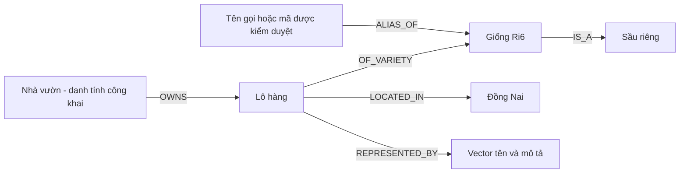
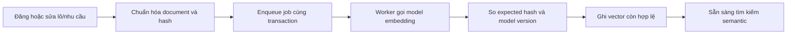
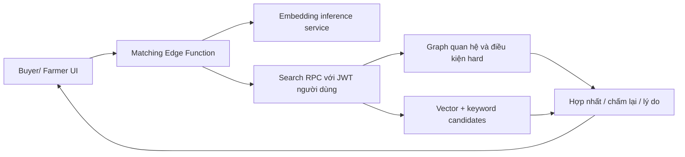

# Kế hoạch matching bằng vector, graph và điều kiện giao dịch

Ngày 15/10/2026. Thiết kế vector + graph ban đầu; các đề xuất alias/graph/LLM chưa code bên dưới giữ làm backlog. **Contract hiện hành là [E5 → vector top 20 → so từ rerank](matching-e5-top20.md)**, thay phương án union keyword/graph và RRF cũ. Công thức giá/lượng giữ làm điểm phụ và fallback.

Trạng thái triển khai 15/10/2026: đã áp migration pgvector, tài liệu tìm kiếm, alias, queue và hai RPC trên Supabase; đã có mã worker/inference, Edge Function và UI bật bằng cờ. Chưa tải/chạy model trên host, chưa deploy Edge Function, chưa benchmark đủ để bật hybrid mặc định. Mọi mục tiêu recall/latency dưới đây vẫn là gate đề xuất, chưa được đo.

**Phạm vi mới nhất 15/10/2026:** E5-base 768 chiều, top 20 theo cosine rồi so từ khớp/gần khớp; chỉ xét sản phẩm, lượng và giá. Map/khoảng cách/ưu tiên tỉnh được hoãn. Giữ các trường địa chỉ/tỉnh/huyện nhưng không dùng làm filter, điểm hoặc đường dẫn ưu tiên. Loại/giống đã chỉ định phải khớp; trạng thái/ngày vẫn kiểm tra tính khả dụng. Core `e5-top20-name-rerank-v2`; migration top 20 còn chờ áp cloud. Trạng thái thực tế xem [implementation status](implementation-status.md).

## 1. Mục tiêu và phạm vi

Thương lái nhập tên/mô tả nông sản và yêu cầu giao dịch, hệ thống tìm lô có ý nghĩa phù hợp, dùng quan hệ nghiệp vụ để xác định/mở rộng đúng loại và giống, rồi xếp hạng bằng độ liên quan sản phẩm, giá và lượng sau khi kiểm tra tính khả dụng. Đơn vị kết quả là lô hàng; một nhà vườn có thể sở hữu nhiều lô khác nhau.

Ví dụ: “Cần Ri6 loại A, khoảng 10 tấn, giá không quá 70 nghìn/kg”. UI hiển thị lại loại/giống, lượng, giá trần và tùy chọn chấp nhận một phần; người dùng có thể sửa trước khi áp các điều kiện suy ra.

Phạm vi triển khai đầu tiên:

- Embedding đa ngôn ngữ cho tên, loại, giống và mô tả công khai của lô; biểu diễn tương ứng cho nhu cầu Buyer để dùng hai chiều.
- Tìm kiếm semantic + keyword, graph nghiệp vụ có node/cạnh được định nghĩa rõ, filter có cấu trúc và reranking.
- Search endpoint dùng chung cho Buyer và Farmer, giữ quyền dữ liệu hiện có.
- UI hiển thị điều kiện đã hiểu, lý do gợi ý, phần lượng còn thiếu, trạng thái kết quả đầy đủ/giới hạn/fallback.
- Benchmark so với matching theo luật để đo chất lượng; không gọi cosine similarity hoặc điểm tổng là xác suất giao dịch.

Chưa triển khai GNN, học graph embedding, dự đoán uy tín từ lịch sử giao dịch, gom nhiều lô thành đơn, giữ hàng hoặc tối ưu vận tải. Các tính năng đó cần dữ liệu và mục tiêu khác.

## 2. Hai lớp graph

| Lớp | Node / cạnh | Mục đích |
| --- | --- | --- |
| Graph vector HNSW | Vector văn bản; cạnh nội bộ nối các vector gần nhau | Tăng tốc nearest-neighbor khi quy mô cần đến |
| Graph nghiệp vụ | Lô, danh tính nhà vườn công khai, loại, giống, khu vực; cạnh có nhãn | Đi theo quan hệ và giải thích đường dẫn đến lô |

HNSW là index graph do pgvector quản lý, không phải graph quan hệ kinh doanh. Giá, số lượng và ngày được giữ dưới dạng thuộc tính của lô; không encode mọi thứ rồi dùng một khoảng cách vector duy nhất cho cả nghiệp vụ. Một metric cố định cũng không thể tự biểu diễn mọi ưu tiên giá/lượng khác nhau của từng Buyer.



Hiện schema đã có phần lớn quan hệ qua khóa ngoại. Triển khai graph nghiệp vụ v1 bằng các bảng quan hệ có kiểu rõ và SQL joins/traversal, chưa cần thêm database graph riêng hoặc bảng cạnh tổng quát chứa ID không có FK.

Quy tắc traversal:

1. Tìm đúng giống “Ri6”: alias → giống → lô, không mở rộng sang giống khác nếu Buyer yêu cầu chính xác.
2. Tìm loại “sầu riêng”: loại → các giống con → lô; loại quả của lô vẫn là điều kiện kiểm tra chính xác.
3. Tìm nhà vườn/khu vực đã được xác định: giới hạn vào tập lô có quan hệ tương ứng, chỉ đọc thông tin công khai.
4. Giới hạn mở rộng taxonomy/alias 1–2 cạnh, tập entity được deduplicate. Mỗi candidate có provenance/path để giải thích nguồn tìm thấy.
5. Không coi hai giống gần nhau về vector là cùng một giống hoặc tự tạo cạnh thay thế. Quan hệ thay thế sản phẩm nếu bổ sung sau cần danh mục kiểm duyệt và tùy chọn người dùng.

Chứng nhận hiện là nhãn tự khai báo. V1 dùng làm thuộc tính/filter với cách gọi “nhà vườn khai báo”; chỉ chuẩn hóa thành node/cạnh khi đã có danh mục và ca truy vấn cần thiết.

## 3. Biểu diễn dữ liệu và model

| Thành phần | Cách biểu diễn | Khi cập nhật |
| --- | --- | --- |
| Tên, loại, giống, grade, mô tả công khai | Canonical text + embedding | Khi nội dung semantic đổi |
| Giá VND/kg, quantity kg, ngày | Cột có kiểu hiện có | Có hiệu lực ngay khi ghi DB |
| Tỉnh/huyện | Nhãn/mã chuẩn hóa, dùng chung A/B | Khi địa điểm thay đổi |
| Tọa độ | Chỉ bổ sung contract phù hợp nếu triển khai tìm bán kính | Không suy ra km từ tên tỉnh |
| Ownership/taxonomy | FK và cạnh nghiệp vụ có kiểu | Theo transaction dữ liệu nguồn |

Canonical document ví dụ: `Sầu riêng; giống Ri6; loại A; mô tả: cơm vàng, thu hoạch tại vườn`. Loại/giống lấy từ catalog, không chỉ tin vào title tự nhập. Không đưa giá sàn, ghi chú nội bộ, số điện thoại hoặc địa chỉ riêng vào embedding. Giá/lượng/ngày/tỉnh được query bằng trường thật; thay đổi các trường đó không cần encode lại nếu canonical text không đổi.

Model khởi đầu để thử nghiệm: `intfloat/multilingual-e5-base`, vector 768 chiều. Chốt model sau benchmark tiếng Việt, chưa khẳng định đây là model tốt nhất. Pin revision, pooling, normalization, dimension và template version. E5 dùng prefix `query:` cho truy vấn và `passage:` cho tài liệu được truy hồi, kể cả tiếng Việt; không trộn vector từ model/template khác trong một phép so sánh.

Hai chiều retrieval:

- Buyer → lots: query từ nhu cầu/từ khóa; passage từ từng lô.
- Farmer → buy_requests: query từ lô của Farmer; passage từ từng nhu cầu OPEN.
- E5 query/passage là bất đối xứng: không hứa semantic score hai chiều giống nhau. Hàm đánh giá giá/lượng/ngày vẫn dùng chung một cặp lot–request; lưu hướng retrieval trong kết quả.

Worker/inference chạy model ở môi trường Python phù hợp. Bản thử nghiệm có thể chạy local; bản triển khai cần service luôn sẵn hoặc provider được chọn sau khi đo độ trễ/chi phí. Edge Function điều phối bằng HTTP, không mặc định tải model PyTorch nặng vào Edge runtime. Chọn môi trường inference là đầu ra của M0, không tự phát sinh chi phí hosting trong bước lập plan.

## 4. Thay đổi schema dự kiến

Tất cả tạo bằng migration mới sau initial schema; không sửa migration đã triển khai. Kiểm tra extension/version có trên project trước khi viết index hoặc bật iterative scan.

| Thành phần mới | Trường/quan hệ chính | Quyền và mục đích |
| --- | --- | --- |
| `fruit_type_aliases` | type_id FK, alias, normalized_alias, locale | Catalog quản trị; authenticated chỉ đọc |
| `fruit_variety_aliases` | variety_id FK, alias, normalized_alias, locale | Tên gọi/mã giống; alias trùng nghĩa trả nhiều lựa chọn, không tự đoán |
| `lot_search_documents` | lot_id FK, canonical_text, search_vector, content_hash, template_version | Document dẫn xuất từ lô và catalog; RLS theo lô nguồn |
| `buy_request_search_documents` | request_id FK, canonical_text, search_vector, content_hash, template_version | Document dẫn xuất từ nhu cầu; RLS theo request nguồn |
| `lot_embeddings` | lot_id FK, model_version, content_hash, embedding vector(D), embedded_at | Unique lot/model; worker ghi, user đọc theo policy lô nguồn |
| `buy_request_embeddings` | request_id FK, model_version, content_hash, embedding vector(D), embedded_at | Unique request/model; worker ghi, user đọc theo policy request nguồn |
| Job queue trong schema nội bộ | target_type/id, model_version, expected_hash, attempts, lease, next_retry_at, status | Claim job nguyên tử, retry, không expose cho frontend |
| Model registry nội bộ | version, model revision, dimension, template, active | Cấu hình do backend quản lý |

`D=768` chỉ được chốt nếu chọn E5-base. Model khác dimension cần cột/bảng/index version mới và backfill; không đổi `model_version` để so sánh các không gian vector khác nhau. Nếu embedding tồn tại nhưng hash không khớp document hiện tại, không sử dụng vector cũ cho semantic search.

Các bảng dẫn xuất public có RLS, grants chỉ đọc cần thiết; user không được tự ghi vector/canonical text/alias. Policy dựa trên quyền đọc bản ghi nguồn, không mở rộng quyền do có search. RPC truy hồi dùng `SECURITY INVOKER`, kiểm tra role và join nguồn có quyền; không trả tài liệu hoặc ID bị cấm rồi mới lọc ở UI.

Worker là tác vụ tin cậy có quyền giới hạn để xử lý queue/tài liệu/embedding. Nếu phải dùng service role, giữ riêng backend và giới hạn thao tác bằng allowlist; endpoint tìm kiếm user vẫn gọi DB bằng JWT của user, không dùng service role để đọc toàn bộ rồi tự lọc.

Index dự kiến: FK/unique cho document và model version; GIN cho `search_vector`; B-tree cho alias đã chuẩn hóa; các index lọc nghiệp vụ hiện có. Bắt đầu bằng exact vector search làm chuẩn. Thêm HNSW cosine khi benchmark cho thấy có ích, thay vì dùng số lô seed để quyết định hiệu năng.

## 5. Luồng cập nhật embedding



1. Trigger tạo canonical document và enqueue job trong transaction ghi dữ liệu. Không gọi model qua mạng bên trong transaction của form.
2. Unique job key `(target_type, target_id, model_version, expected_hash)` để retry không tạo trùng. Worker claim bằng lease; lease hết hạn có thể được worker khác nhận lại.
3. Encode theo batch có giới hạn, timeout và backoff. Sau số lần thử cấu hình, đưa vào failed queue có công cụ retry; không làm người dùng mất bản ghi lô vừa lưu.
4. Trước khi ghi vector, kiểm tra source còn tồn tại, hash/model còn đúng. Job của phiên bản nội dung cũ phải bị bỏ, tránh ghi đè embedding mới. Document FK cascade khi nguồn bị xóa; job mồ côi được đánh dấu bỏ qua.
5. Lô CLOSED/CANCELLED không được tìm thấy ngay theo trạng thái nguồn, dù vector chưa được dọn. Khi title/mô tả đổi, vector cũ bị xem là stale; lô vẫn có thể tìm bằng keyword/structured fallback từ document mới.
6. Đổi tên loại/giống cũng cần cập nhật các document phụ thuộc. Đổi alias chỉ cập nhật entity resolution/keyword expansion nếu alias không nằm trong canonical document.
7. Backfill theo batch resumable; theo dõi coverage, pending/failed/stale, tuổi job lâu nhất. Có tác vụ đối soát hash để phát hiện bỏ sót sự kiện.

Supabase có hướng dẫn kiến trúc trigger/queue/worker cho embedding bất đồng bộ; cách hiện thực queue cụ thể sẽ được chọn ở M2 sau khi kiểm tra extension của project: [Automatic embeddings](https://supabase.com/docs/guides/ai/automatic-embeddings).

## 6. Luồng truy vấn và thuật toán

### 6.1 Hiểu truy vấn

Ưu tiên form có cấu trúc + ô từ khóa. Parser v1 dùng danh mục alias và quy tắc nhận dạng đơn vị tiền/khối lượng; chuẩn hóa chữ, dấu và khoảng trắng cho lookup nhưng giữ nguyên tiếng Việt có dấu cho embedding. Không xóa dấu khỏi canonical text của model.

Mỗi điều kiện được gắn `source` (form hoặc parsed), `mode` (hard/preferred) và trạng thái xác nhận. Form do người dùng chọn có ưu tiên cao hơn phần suy ra. “Ri6” ánh xạ giống khi rõ; tên nhập mơ hồ hoặc địa danh không nhận diện được phải hiển thị lựa chọn/giữ thành text, không áp hard filter đoán mò. Mốc tương đối như “tuần sau” cần resolve thành ngày cụ thể với timezone và hiển thị lại.

LLM extraction là mở rộng tùy chọn sau parser v1, vẫn phải validate schema và xác nhận điều kiện mơ hồ. Không cần LLM sinh câu trả lời để xếp hạng lô.

### 6.2 Điều kiện bắt buộc

Áp quyền truy cập, trạng thái, fruit/variety đã xác định, khoảng ngày giao nhau, min_lot và `allow_partial` như contract hiện có. Giá tối đa/ngân sách người dùng đánh dấu bắt buộc là hard filter; điểm semantic cao không bù cho vi phạm.

Giá mong muốn và lượng mục tiêu là ưu tiên mềm hiện tại. Khi không cho phép một phần, lượng lô phải >= target. Tỉnh không tham gia matching. Grade/chứng nhận là dữ liệu tham khảo; nếu sau này cho bật thành yêu cầu bắt buộc phải kiểm tra bằng trường dữ liệu, không chỉ similarity.

Các filter hard được truyền xuống từng nhánh query và kiểm tra lại trước trả kết quả. Không chỉ lấy top semantic không lọc rồi bỏ các record vi phạm, vì có thể mất các lô hợp lệ nằm ngoài top ban đầu.

### 6.3 Truy hồi vector top 20 trước khi so từ

1. E5 embed tên query hoặc tên sản phẩm nguồn; query/passages cùng model version và convention.
2. RPC mới `search_lot_vector_top20` / `search_request_vector_top20` đọc dưới JWT/RLS của caller, áp điều kiện hard và chỉ đọc vector đúng model/content hash.
3. Cosine search trong pgvector, sort giảm dần rồi ID, **limit 20**. Không union lexical/graph, không đưa record chưa có vector vào pool này.
4. Service giữ nguyên pool, đọc lại dữ liệu hiện tại, so từ chính xác/gần đúng và loại trừ. Không bù ứng viên thứ 21 nếu một kết quả bị loại.
5. Rerank toàn bộ pool trước phân trang; trả cosine gốc và `rankingScope=vector_top20`. Ưu tiên tên sản phẩm trước giá/lượng.

Core kiểm tra giới hạn 20 lần nữa để chặn ứng viên ngoài pool. SQL dùng cosine exact hiện tại; chỉ thêm HNSW sau khi đo recall/latency. Candidate recall ngoài top 20 là giới hạn có chủ ý của pipeline mới, không thể sửa bằng reranker.

HNSW dùng tìm kiếm xấp xỉ; bộ lọc có thể làm trả thiếu kết quả. Cần đo recall theo từng nhóm filter, thử iterative scan nếu version hỗ trợ, tăng search budget hoặc dùng exact search khi tập lọc nhỏ. Không quảng bá top toàn bộ database từ pool bị cắt. [pgvector filtering](https://github.com/pgvector/pgvector#filtering)

### 6.4 So từ và xếp hạng

Trong vector top 20: khớp đầy đủ từ → gần khớp đầy đủ → khớp một phần → chưa khớp từ. Trong cùng nhóm, xét độ phủ/độ gần từ, sau đó điểm phụ cosine/giá/lượng, cuối cùng ID. Chuẩn hóa tiếng Việt, so token đầy đủ và chỉnh sửa ký tự có giới hạn; mã chứa số như Ri6/Ri7 và từ ngắn chỉ so chính xác. Một số cụm loại trừ rõ được xử lý; không giả lập khả năng hiểu mọi câu phủ định.

Không dùng RRF để mở rộng/hợp nhất pool. `nameMatch` và cosine được trả riêng để biết lý do thứ tự. Tên chuẩn lấy từ catalog; fuzzy không tự kết luận mọi alias là cùng giống.

```text
relevance = clamp(cosineSimilarity, 0, 1)

score = 100 × (0.45 × relevance
             +0.25 × priceFit
             +0.20 × quantityFit) / 0.90
```

Đây là trọng số/ngưỡng khởi đầu cần tune trên development set, được xét sau mức khớp tên. Giữ tỷ lệ cosine/giá/lượng 45:25:20, chuẩn hóa về 100; không có điểm khu vực.

- `priceFit`: giữ phép tính theo khoảng giá của baseline cho giá ưu tiên mềm; vi phạm giá hard đã bị loại. Nếu không có nhu cầu/ngân sách, không giả lập mức phù hợp giá.
- `quantityFit = min(lot.quantity_kg / request.target_quantity_kg, 1)` cho cặp có target hợp lệ; trả contribution/remaining như baseline. Không coi quantity là lượng còn lại sau đặt hàng.
- Khu vực/địa chỉ/khoảng cách: chỉ giữ dữ liệu để dùng sau, không tham gia score hoặc eligibility trong phạm vi hiện tại.
- Nếu chỉ duyệt text trên web, chưa chọn request/target/giá: dùng so từ local, không gắn điểm thương mại giả định. RPC vector hiện yêu cầu source thuộc tài khoản.
- Quan hệ loại/giống phục vụ eligibility/provenance; không mở rộng pool sau vector top 20 hoặc cộng graph score.
- Sort theo nhóm/độ khớp tên trước score chưa làm tròn, rồi ID. Không coi cosine hoặc score là xác suất giao dịch.
- Khi cần ngưỡng liên quan tối thiểu để bỏ kết quả không liên quan, hiệu chỉnh trên tập có nhãn theo mode/entity. Không tự đặt một cosine threshold dùng chung cho mọi model.

Baseline hiện tại: `100 × (0.40 × priceFit + 0.35 × quantityFit) / 0.75`. Các cặp seed Ri6/mít/thanh long tương ứng 67,33 / 84,44 / 76,67 điểm; không phải kết quả kỳ vọng của hybrid.

### 6.5 Lý do kết quả và trường hợp suy giảm

Trả mức khớp từ/gần khớp/một phần và dữ liệu đã kiểm tra như giá trong khoảng, đóng góp 15/50 tấn; không thêm lý do ưu tiên tỉnh. Không biến similarity thành chứng nhận thuộc tính chưa có trong DB.

Nếu inference lỗi/không có: fallback theo quy tắc và so từ, trả `mode=degraded`, ghi rõ chưa dùng E5. Nếu query E5 hợp lệ nhưng không có passage vector thì pool vector rỗng; không union record chưa có vector để giả top 20. Luồng đầy đủ và giới hạn triển khai ở [contract E5 mới](matching-e5-top20.md).

## 7. Backend, API và UI



API dự kiến: một `search-matches` Edge Function điều phối; RPC riêng cho hướng Buyer/Farmer để dễ kiểm tra policy. Core score/eligibility/config là module TypeScript dùng chung backend/test; UI nhận kết quả từ server và không tự dựng một kết quả khác. Các hàm này chưa tồn tại.

Request gồm direction, sourceId (request của Buyer hoặc lot của Farmer), text, filters có hard/preferred, pageSize/cursor. Server đọc lại source bằng JWT, validate role/ownership, giới hạn text/page/filter và dùng model/rule do server quản lý. Client không được chọn tùy ý model dimension hoặc gửi owner giả để mở rộng dữ liệu.

Response gồm items và metadata: `modelVersion`, `ruleVersion`, `mode`, `ranking_scope`, `truncated`, `candidateCount`, `generatedAt`, cursor. Mỗi item có ID, score/breakdown khi đủ dữ liệu thương mại, reasons/warnings, graph paths và contribution/remaining kg. `candidateCount` không phải tổng thị trường; chỉ trả total chính xác nếu query riêng đã tính đúng trên tập có quyền.

Phân trang trên cùng pool đã xếp hạng. Dùng search session/cursor ràng buộc user, source hash, filters, model/rule và corpus version với TTL đề xuất 60 giây; cache kết quả ở backend, không giữ trong bộ nhớ một Edge instance như kho bền vững. Trang tiếp theo và mở chi tiết kiểm tra lại quyền/trạng thái nguồn; nếu corpus/source thay đổi đáng kể thì yêu cầu refresh. Không trả lô đã đóng từ cache.

Cache query embedding theo user + normalized semantic text + model/template, xóa/hết hạn theo policy; cache tập kết quả còn phải có filter/source/version. Debounce UI khoảng 300ms và bỏ response cũ khi query thay đổi. Giới hạn tần suất/độ dài/batch để kiểm soát inference load; log thời gian và mã lỗi thay vì password/token/nội dung riêng.

UI cần bổ sung:

- Ô tìm kiếm tự nhiên cùng form filter rõ ràng; chips cho loại/giống/tỉnh/giá/lượng/ngày đã hiểu.
- Phân biệt “Bắt buộc” và “Ưu tiên”, cùng tùy chọn cho phép một phần nhu cầu.
- Card/modal “Vì sao phù hợp?” với lý do theo dữ liệu và đường quan hệ khi có ích.
- Empty state phân biệt không có lô hợp lệ, quá nhiều kết quả cần lọc, và tìm kiếm dự phòng.
- Trạng thái “Đang cập nhật tìm kiếm ngữ nghĩa” cho chủ lô khi embedding pending; thao tác lưu lô không bị phụ thuộc model.

## 8. Đo chất lượng và kiểm thử

6 lô seed hiện tại chỉ dùng smoke test. Tạo bộ dữ liệu đánh giá riêng, không tự nạp hàng trăm record benchmark vào project dùng chung.

Dataset ban đầu đề xuất: >=300 lô hư cấu đa dạng và >=150 truy vấn/nhu cầu có nhãn relevance 0–3 cùng nhãn hard eligibility. Có truy vấn không có đáp án, không dấu/typo, alias, giống dễ nhầm, giá/đơn vị, ngày biên, tỉnh khác, thiếu dữ liệu và trường hợp chấp nhận một phần. Chia development/test theo nhóm ý định hoặc họ truy vấn; giữ khoảng 30% test không dùng để tune trọng số. A/B review nhãn cho các ca nghiệp vụ quan trọng; các lô seed không được là toàn bộ ground truth.

So sánh bốn cấu hình trên cùng dữ liệu và filter: rule-only; keyword + rule; vector + keyword + rule; vector + keyword + graph + rule. Ablation graph phải có ca alias/taxonomy/mở rộng quan hệ thực sự; nếu không cải thiện thì giữ graph để giải thích và không quảng bá tăng chất lượng chưa đo được.

| Chỉ số / kiểm thử | Gate đề xuất, chưa đo |
| --- | --- |
| Vi phạm hard constraint / rò dữ liệu trái quyền | 0 trong toàn bộ test |
| Candidate Recall@100 | >=95% trên nhóm query có 1–100 đáp án relevance >=2 và hợp lệ; query có >100 đáp án báo riêng cùng ceiling 100/số đáp án, không áp gate 95% bất khả thi |
| NDCG@10 | Mục tiêu tăng >=5% tương đối so với keyword + rule; báo riêng nhóm alias/ngữ nghĩa và nhóm mã giống chính xác |
| HNSW recall so với exact vector | >=95% trên tập test và các filter đại diện trước khi bật mặc định |
| Độ trễ | Mục tiêu p95 <=2 giây warm tại corpus 10.000 lô trên cấu hình máy được ghi rõ; cold start đo riêng |
| Index freshness | Mục tiêu 95% job hoàn tất <=60 giây khi inference service sẵn; lô đóng bị loại ngay theo DB |
| Fallback | Inference timeout/lỗi vẫn tìm được theo keyword/graph/luật, có cờ degraded |
| Tính đúng pipeline | Duplicate job, stale write, delete/close giữa lúc xử lý, model đổi version, cache khác user |

Nếu gate chất lượng chưa đạt: phân tích candidate recall trước rồi mới tune reranking/model; không chỉ tăng trọng số để che candidate bị mất. Nếu HNSW không có lợi ở quy mô thật, dùng exact search. Mục tiêu latency/recall là tiêu chí đánh giá, không phải kết quả đã đạt hoặc cam kết hạ tầng.

Bộ PGlite hiện có vẫn chạy cho schema gốc. Các test extension/vector/queue/RPC phải chạy trên PostgreSQL có extension đúng version hoặc Supabase local/test phù hợp; không mặc định PGlite đã hỗ trợ đủ extension mới. Integration test phải gồm JWT/HTTP và hai phía Buyer/Farmer, không chỉ SQL bằng quyền quản trị.

## 9. Backlog triển khai và phối hợp A/B

| Mốc | Việc / đầu ra | Ước lượng Dev B |
| --- | --- | --- |
| M0 | Chốt contract hard/soft, fixture benchmark, model spike và môi trường inference | 1–2 ngày |
| M1 | Migration pgvector/documents/aliases; graph query có path; RLS và generated types | 1–2 ngày |
| M2 | Queue/worker, content hash, retry/backfill, index freshness | 1,5–2 ngày |
| M3 | Query parser, semantic + keyword + graph retrieval, exact baseline; thử HNSW | 1,5–2 ngày |
| M4 | RRF/reranking, explanations, search API, cache/cursor và fallback | 1–2 ngày |
| M5 | UI chips/hard-soft/reasons và tích hợp hai chiều với A | 1 ngày |
| M6 | Benchmark/ablation, load/RLS/failure tests, tài liệu và rollout | 1–2 ngày |

Tổng ước lượng phần vector/graph: khoảng 8–13 ngày Dev B, bao gồm prototype và đánh giá đầu tiên. Có thể code contract/fixture/API mock trong lúc chờ inference host. Không tính thời gian chờ hosting, credential hoặc thay model do chất lượng không đạt. Thay B4 cũ 1,5–2 ngày bằng chuỗi M0–M6; toàn bộ phần Dev B ước tính lại khoảng 18–25 ngày làm việc nếu một người thực hiện tuần tự, A vẫn làm phần A song song.

Dev B sở hữu search architecture, schema dẫn xuất, worker, thuật toán/API, benchmark và UI Buyer. Dev A bàn giao catalog/đơn vị/các trường lô theo contract, kiểm tra sự kiện tạo/sửa/đóng lô, upload ảnh và tích hợp endpoint Farmer. Không nhân đôi model service hoặc scoring giữa A/B. OTP và đăng ký demo đã bỏ theo quyết định 15/10/2026; Admin, chat và vận chuyển vẫn theo phạm vi demo trước đây.

Trình tự tích hợp: M0 tạo benchmark baseline → M1 tạo dữ liệu dẫn xuất → M2 backfill → M3/M4 chạy API → M5 nối UI → M6 quyết định bật mặc định. M0–M2 có thể bắt đầu sau khi chốt contract, không cần đợi toàn bộ UI Buyer hoàn thành.

## 10. Rollout và bàn giao

1. Feature flag `rule-only` / `hybrid`, default rule-only cho đến khi gate đạt. So sánh song song trong môi trường test trước khi bật hybrid.
2. Apply migration additive, bật worker và backfill; quan sát coverage/failed queue. Chuyển model mới qua version riêng, hoàn thành backfill rồi đổi active version; giữ khả năng quay lại model/rule cũ.
3. Rollback vận hành bằng chuyển flag/model version và dừng nhận job mới; không drop bảng hoặc reset dữ liệu nghiệp vụ. Dọn dữ liệu dẫn xuất cũ là việc riêng sau khi xác nhận không cần nữa.
4. Deliverables: migrations và RLS tests; worker/config; search endpoint và API contract; core scoring; bộ benchmark + kết quả đo; UI tìm kiếm/lý do; hướng dẫn vận hành/retry/backfill và bảng chi phí/độ trễ của môi trường đã chọn.

Trước khi implementation cần chốt trong M0: host/provider embedding, ngân sách vận hành nếu có, alias/taxonomy ban đầu, nhãn benchmark, mode hard/soft mặc định. Có thể làm prototype local và xây dataset trước, chưa cần mua dịch vụ hoặc thay quyền cloud.

Nguồn kỹ thuật: [pgvector và HNSW](https://github.com/pgvector/pgvector#hnsw), [Supabase hybrid search](https://supabase.com/docs/guides/ai/hybrid-search), [Supabase automatic embeddings](https://supabase.com/docs/guides/ai/automatic-embeddings), [multilingual-e5-base model card](https://huggingface.co/intfloat/multilingual-e5-base). Các công thức, schema mới, budget và mốc thời gian trong tài liệu là đề xuất thiết kế cho LogStar.
